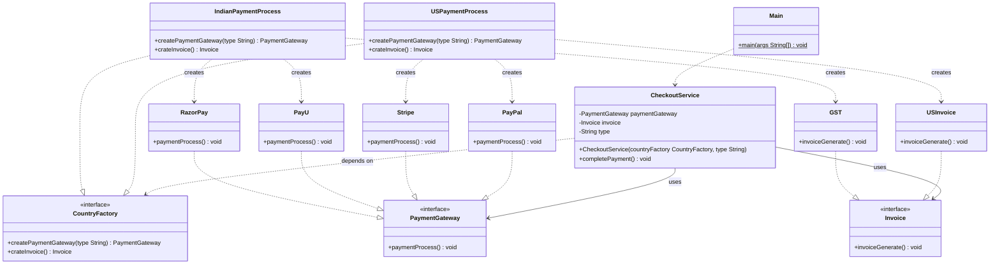

# Abstract Factory Pattern
> A factory of factories: create families of related objects without naming their concrete classes.

**Category:** Creational &nbsp;|&nbsp; **My example:** Checkout service - PaymentGateway + Invoice per country (India / US) &nbsp;|&nbsp; [Back to main README](../../../README.md) &nbsp;|&nbsp; [Introduction](../../../introduction/README.md)

**Intent:** Provide an interface for creating families of dependent objects without specifying their concrete classes.

## Contents

[Code in this folder](#code-in-this-folder) · [Problem](#the-problem) · [Solution](#the-solution) · [Class diagram](#class-diagram) · [Who plays what](#who-plays-what) · [Pros and cons](#pros-and-cons) · [When to use](#when-to-use-it) · [What I learnt](#what-i-learnt) · [Things to improve in my code](#things-to-improve-in-my-code) · [Interview questions](#possible-interview-questions) · [My notes](#my-handwritten-notes)

## Code in this folder

```text
abstractFactoryPattern/
├── abstractFactoryPatternExample/
│   ├── concreteClasses/
│   │   ├── indian/
│   │   │   ├── GST.java
│   │   │   ├── IndianPaymentProcess.java
│   │   │   ├── PayU.java
│   │   │   └── RazorPay.java
│   │   └── us/
│   │       ├── PayPal.java
│   │       ├── Stripe.java
│   │       ├── USInvoice.java
│   │       └── USPaymentProcess.java
│   ├── interfaces/
│   │   ├── CountryFactory.java
│   │   ├── Invoice.java
│   │   └── PaymentGateway.java
│   ├── service/
│   │   └── CheckoutService.java
│   └── Main.java
└── problem/
    ├── concreteClasses/
    │   ├── GST.java
    │   ├── PayU.java
    │   └── RazorPay.java
    ├── factory/
    │   └── CheckoutFactory.java
    ├── interfaces/
    │   ├── Invoice.java
    │   └── PaymentGateway.java
    ├── service/
    │   └── Checkout.java
    └── Main.java
```

- `problem/` - the code *without* the pattern, showing why it hurts (the comments at the top of `Main.java` explain it).
- the `...Example/` folder - the same requirement solved *with* the pattern.
- `diagrams/` - Mermaid class diagrams (Lucidchart-ready). `notes/` - photos of my handwritten notes.

## The problem

The Indian checkout uses `CheckoutFactory` which creates a payment gateway (RazorPay / PayU) **and** an invoice (GST).
When the US is added, you either add another factory class or more `if/else` - the one-factory design stops being a clean Factory pattern, and `Checkout` has to change (violating SRP and OCP).

## The solution

Create a `CountryFactory` **interface** that declares *both* products: `createPaymentGateway(type)` and `crateInvoice()`.
Each country supplies one implementation: `IndianPaymentProcess` (RazorPay/PayU + GST) and `USPaymentProcess` (Stripe/PayPal + USInvoice).
`CheckoutService` receives a `CountryFactory` in its constructor and only talks to `PaymentGateway` and `Invoice` interfaces -
a new country means new classes only; `CheckoutService` never changes. It also guarantees a consistent family (you can't mix a US gateway with a GST invoice).

## Class diagram

> **Lucidchart:** copy the code block (or open the matching file in [`diagrams/`](diagrams/)), open a new Lucidchart document, choose **Diagram as code** (the `</>` icon), paste it and Lucidchart builds the class diagram. Details are in the [main README](../../../README.md#class-diagrams-and-lucidchart). GitHub also renders the same block as a diagram.



*Matches your notes: `CountryFactory` with the Indian/US factories, the `PaymentGateway` family and the `Invoice` family.*

Legend: `..|>` implements - `--|>` extends - `..>` depends on / creates - `-->` association - `o--` aggregation - `*--` composition. `+` public, `-` private, `#` protected, `~` package, `$` static, `*` abstract.

### Who plays what

| Role in the pattern | Class in my code |
|---|---|
| Abstract factory | `CountryFactory` |
| Concrete factories | `IndianPaymentProcess`, `USPaymentProcess` |
| Abstract products | `PaymentGateway`, `Invoice` |
| Concrete products | `RazorPay`, `PayU`, `Stripe`, `PayPal`, `GST`, `USInvoice` |
| Client | `CheckoutService` |

## Pros and cons

**Pros**

- Consistency (products of one family belong together)
- Decouples the client from concrete implementations
- Promotes OCP
- Scalable and flexible
- Centralised object-creation logic

**Cons**

- Increased complexity
- Over-engineering for small problems
- Addition of more code

## When to use it

**Use it when**

- You need families of related objects that must be used together (gateway + invoice)
- The client must stay independent of how products are created

**Avoid it when**

- Only one product type or one family - a plain Factory is enough

**Real-world examples**

- Checkout / payment service across countries
- UI toolkits (Windows vs Mac widgets)

## What I learnt

- Abstract Factory = **a group of multiple factories wrapped inside a single interface**; it is a creational pattern that creates *families of dependent objects* without specifying their concrete classes.
- Instead of many factory classes, I made one **factory interface** that many classes can implement - one per country.
- Adding a US checkout = just new classes. I never touch `CheckoutService`, so **SRP and OCP** are followed.
- The client depends on the factory *interface* and is given the factory from outside (`new CheckoutService(new USPaymentProcess(), "paypal")`) - the idea behind dependency injection.
- Trade-off: adding a *new product type* to the family (e.g. `TaxCalculator`) forces a change in the interface and in every factory.

## Things to improve in my code

Small things I noticed while reviewing the examples - good practice for spotting issues in an interview too:

- Typo: `USPaymentProcess` matches the string `"strpie"` - it should be `"stripe"`. With the right spelling the US demo would work for Stripe.
- `indian/RazorPay.paymentProcess()` prints `"PayU Payment has been invoked"` (copy-paste) - same in `problem/RazorPay`.
- `crateInvoice()` should be `createInvoice()` (interface and both factories).
- `CheckoutService` stores `type` but never uses it - remove the field.
- Gateway type is a free-form `String`. An `enum PaymentType` would catch typos at compile time.

## Possible interview questions

Click a question to see a short answer.

<details>
<summary><b>1. Abstract Factory vs Factory?</b></summary>

Factory creates one kind of product. Abstract Factory creates a *family* of related products through one interface, ensuring they are compatible.

</details>

<details>
<summary><b>2. How is it related to Factory Method?</b></summary>

Each `create...()` method on an abstract factory is itself a factory method; the abstract factory groups several of them.

</details>

<details>
<summary><b>3. How do you add a new country (say UK)?</b></summary>

Create `UKPaymentProcess implements CountryFactory` plus the UK products. No existing class changes - OCP.

</details>

<details>
<summary><b>4. What is the main drawback?</b></summary>

Adding a new product to the family requires changing the factory interface and all concrete factories. It also adds many classes.

</details>

<details>
<summary><b>5. Why is the factory passed through the constructor?</b></summary>

So `CheckoutService` depends only on the abstraction and can be given any family (and a mock in tests) - dependency inversion/injection.

</details>

<details>
<summary><b>6. Which principles does it demonstrate?</b></summary>

SRP, OCP, DIP, and consistency between related products.

</details>

<details>
<summary><b>7. Where is it used in real systems or the JDK?</b></summary>

Commonly cited examples: cross-platform UI toolkits (one factory per OS creating buttons, menus ...), JAXP factories such as `DocumentBuilderFactory`, and drivers that produce related connection/statement objects.

</details>

<details>
<summary><b>8. Would you use it for just two gateways in one country?</b></summary>

No - a simple Factory is enough. Use Abstract Factory only when there are multiple related product families.

</details>


