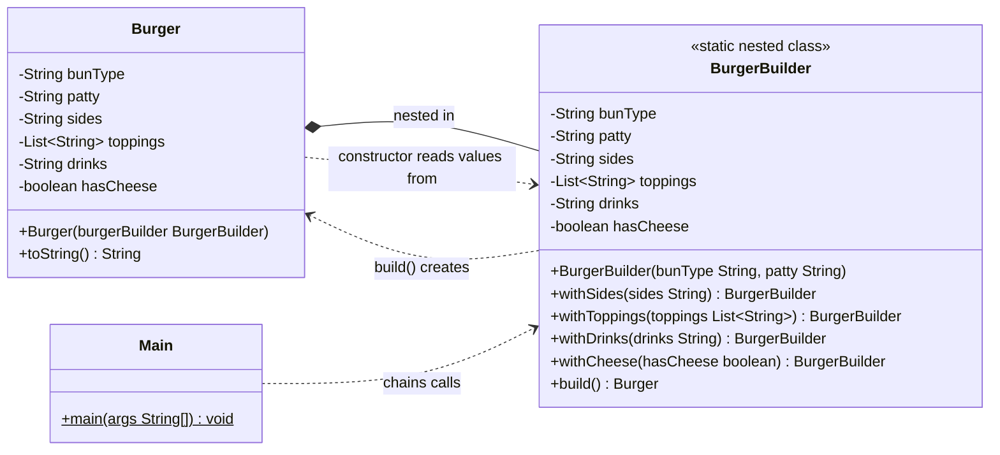

# Builder Pattern
> Construct complex objects step by step, separating construction from representation.

**Category:** Creational &nbsp;|&nbsp; **My example:** Food delivery app - building a Burger order &nbsp;|&nbsp; [Back to main README](../../../README.md) &nbsp;|&nbsp; [Introduction](../../../introduction/README.md)

**Intent:** Build an object with many optional parts through readable, chained steps instead of giant constructors.

## Contents

[Code in this folder](#code-in-this-folder) · [Problem](#the-problem) · [Solution](#the-solution) · [Class diagram](#class-diagram) · [Who plays what](#who-plays-what) · [Pros and cons](#pros-and-cons) · [When to use](#when-to-use-it) · [What I learnt](#what-i-learnt) · [Things to improve in my code](#things-to-improve-in-my-code) · [Interview questions](#possible-interview-questions) · [My notes](#my-handwritten-notes)

## Code in this folder

```text
builderPattern/
├── builderPatternExample/
│   ├── Burger.java
│   └── Main.java
└── problem/
    ├── Burger.java
    └── Main.java
```

- `problem/` - the code *without* the pattern, showing why it hurts (the comments at the top of `Main.java` explain it).
- the `...Example/` folder - the same requirement solved *with* the pattern.
- `diagrams/` - Mermaid class diagrams (Lucidchart-ready). `notes/` - photos of my handwritten notes.

## The problem

A `Burger` needs a `bunType` and `pattyType`. Later we want optional **sides, toppings, cheese, drinks**.
Adding them to the constructor gives a long parameter list; callers who don't want them must write `new Burger("Italian", "Chicken", null, null, false)`.
Constructor overloading creates a combinatorial number of constructors - the **telescoping constructor anti-pattern** (Java has no default parameter values).

## The solution

Put a static nested `BurgerBuilder` inside `Burger`:
* **Required** fields (`bunType`, `patty`) are passed to the builder's constructor.
* **Optional** fields are set with fluent methods (`withSides`, `withToppings`, `withDrinks`, `withCheese`) that `return this`.
* `build()` calls `new Burger(this)`, which copies the values into `final` fields - so a built `Burger` is **immutable**.

```java
Burger b = new Burger.BurgerBuilder("Italian", "chicken")
                .withCheese(false).withDrinks("Sprite").withSides("French Fries").build();
```

## Class diagram

> **Lucidchart:** copy the code block (or open the matching file in [`diagrams/`](diagrams/)), open a new Lucidchart document, choose **Diagram as code** (the `</>` icon), paste it and Lucidchart builds the class diagram. Details are in the [main README](../../../README.md#class-diagrams-and-lucidchart). GitHub also renders the same block as a diagram.



*`BurgerBuilder` is a static nested class of `Burger`, so it can reach `Burger`'s constructor and fields.*

Legend: `..|>` implements - `--|>` extends - `..>` depends on / creates - `-->` association - `o--` aggregation - `*--` composition. `+` public, `-` private, `#` protected, `~` package, `$` static, `*` abstract.

### Who plays what

| Role in the pattern | Class in my code |
|---|---|
| Product | `Burger` |
| Builder | `Burger.BurgerBuilder` |
| Client | `Main` |

## Pros and cons

**Pros**

- Avoids constructor overloading
- Ensures immutability
- Clean, readable object creation
- Great for complex configuration

**Cons**

- Slightly tough to set up
- Overkill for small classes
- A separate builder class is needed

## When to use it

**Use it when**

- The object has multiple fields (especially optional ones)
- Immutability is preferred
- You want readable, maintainable object creation

**Avoid it when**

- The class has only 1-2 fields
- You don't need customisation or immutability

**Real-world examples**

- Lombok `@Builder` (Java library)
- Amazon cart / order objects

## What I learnt

- Builder is a **creational** pattern that builds complex objects *step by step* and separates **construction** from **representation**.
- The **telescoping constructor** anti-pattern: many constructors with different parameters. Don't use constructor overloading if you have more than **one** optional parameter.
- Required values go through the builder's constructor; optional ones through setter-style methods that return `this` - that is what makes chaining possible.
- `build()` passes `this` to the outer class constructor, which copies the values into `final` fields -> immutable object.
- Refinement to my notes: a static nested class is the usual Java idiom (it needs access to the outer constructor), but the pattern itself does not *require* an inner class.

## Things to improve in my code

Small things I noticed while reviewing the examples - good practice for spotting issues in an interview too:

- `List.of("Pepper,Onion")` creates **one** topping called `"Pepper,Onion"`. You probably meant `List.of("Pepper", "Onion")`.
- `Burger`'s constructor is `public`, so anyone can bypass the builder. Make it `private` (the nested builder can still call it).
- `toppings` is stored by reference. For true immutability copy it: `this.toppings = builder.toppings == null ? List.of() : List.copyOf(builder.toppings);`
- `build()` doesn't validate anything (e.g. null `bunType`). Builders are the right place for this.
- `Main` has unused imports (`java.lang.reflect.Array`, `java.util.Arrays`). `Burger` has no getters yet.

## Possible interview questions

Click a question to see a short answer.

<details>
<summary><b>1. What is the telescoping constructor problem?</b></summary>

Many overloaded constructors for every combination of optional parameters. They are hard to read, easy to call with arguments in the wrong order, and don't scale.

</details>

<details>
<summary><b>2. Builder vs constructor vs JavaBeans setters?</b></summary>

Constructors with many args are unreadable; setters leave the object half-built and mutable between calls. Builder gives named, chained steps and produces a complete, immutable object in `build()`.

</details>

<details>
<summary><b>3. Why is the builder usually a static nested class?</b></summary>

It needs access to the outer class's private constructor and fields, and it exists independently of any `Burger` instance, so it must be `static`.

</details>

<details>
<summary><b>4. How does Builder give immutability?</b></summary>

The product's fields are `final` and set once in its constructor from the builder; there are no setters afterwards.

</details>

<details>
<summary><b>5. Builder vs Factory?</b></summary>

A factory decides *which class* to create and usually returns the object in one call. A builder decides *how to assemble one complex object* step by step.

</details>

<details>
<summary><b>6. Where would you put validation?</b></summary>

In `build()` (or the product's constructor) so that an invalid object can never be created.

</details>

<details>
<summary><b>7. Is the builder thread-safe?</b></summary>

Builders are normally used by one thread and are not thread-safe; the objects they produce are immutable and therefore safe to share.

</details>

<details>
<summary><b>8. What does Lombok's `@Builder` do?</b></summary>

It generates the builder class and fluent methods at compile time - the same pattern without boilerplate.

</details>

<details>
<summary><b>9. What is the Director in the classic GoF Builder?</b></summary>

An optional class that knows the order of build steps for common recipes (e.g. `makeCheeseBurger()`), so clients don't repeat them.

</details>

<details>
<summary><b>10. When should you avoid Builder?</b></summary>

For classes with one or two fields, or where immutability/customisation isn't needed - a constructor is simpler.

</details>


