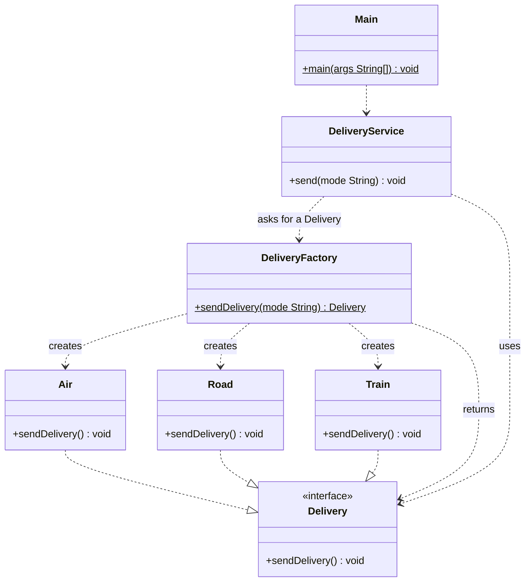

# Factory Pattern
> Create objects without telling your code exactly which class to use.

**Category:** Creational &nbsp;|&nbsp; **My example:** Delivery modes (Air, Road, Train) &nbsp;|&nbsp; [Back to main README](../../../README.md) &nbsp;|&nbsp; [Introduction](../../../introduction/README.md)

**Intent:** Move the decision of *which concrete class to instantiate* out of the client and into one place.

## Contents

[Code in this folder](#code-in-this-folder) · [Problem](#the-problem) · [Solution](#the-solution) · [Class diagram](#class-diagram) · [Who plays what](#who-plays-what) · [Pros and cons](#pros-and-cons) · [When to use](#when-to-use-it) · [What I learnt](#what-i-learnt) · [Things to improve in my code](#things-to-improve-in-my-code) · [Interview questions](#possible-interview-questions) · [My notes](#my-handwritten-notes)

## Code in this folder

```text
factoryPattern/
├── factoryPatternExample/
│   ├── concreteClasses/
│   │   ├── Air.java
│   │   ├── Road.java
│   │   └── Train.java
│   ├── factory/
│   │   └── DeliveryFactory.java
│   ├── interfaces/
│   │   └── Delivery.java
│   ├── service/
│   │   └── DeliveryService.java
│   └── Main.java
└── problem/
    ├── concreteClasses/
    │   ├── Air.java
    │   └── Road.java
    ├── interfaces/
    │   └── Delivery.java
    ├── service/
    │   └── DeliveryService.java
    └── Main.java
```

- `problem/` - the code *without* the pattern, showing why it hurts (the comments at the top of `Main.java` explain it).
- the `...Example/` folder - the same requirement solved *with* the pattern.
- `diagrams/` - Mermaid class diagrams (Lucidchart-ready). `notes/` - photos of my handwritten notes.

## The problem

`DeliveryService.send(mode)` does two jobs: it **decides** which delivery type is needed and it **creates** it with `new Air()` / `new Road()`.
That breaks the Single Responsibility Principle, and adding a new mode (Train) means editing `DeliveryService` - which breaks the Open/Closed Principle.

## The solution

Introduce a `Delivery` interface and a `DeliveryFactory` that returns the right implementation for a mode string.
`DeliveryService` just asks the factory and calls `sendDelivery()` - it never mentions `Air`, `Road` or `Train`.
When a new mode appears you add a class and one line in the factory; the service is untouched.

## Class diagram

> **Lucidchart:** copy the code block (or open the matching file in [`diagrams/`](diagrams/)), open a new Lucidchart document, choose **Diagram as code** (the `</>` icon), paste it and Lucidchart builds the class diagram. Details are in the [main README](../../../README.md#class-diagrams-and-lucidchart). GitHub also renders the same block as a diagram.



*Same shape as the diagram in your notes (Notification / Email / WhatsApp / Factory / NotificationService).*

Legend: `..|>` implements - `--|>` extends - `..>` depends on / creates - `-->` association - `o--` aggregation - `*--` composition. `+` public, `-` private, `#` protected, `~` package, `$` static, `*` abstract.

### Who plays what

| Role in the pattern | Class in my code |
|---|---|
| Product (interface) | `Delivery` |
| Concrete products | `Air`, `Road`, `Train` |
| Factory | `DeliveryFactory` |
| Client | `DeliveryService` |

## Pros and cons

**Pros**

- Promotes loose coupling
- Enhances extensibility (OCP)
- Centralises object creation (SRP)
- Increases flexibility
- Improves code reusability

**Cons**

- Increased complexity
- More code overhead

## When to use it

**Use it when**

- The client does not know the exact class of the object it needs
- You want to decouple object-creation logic from client code
- Creation is complex or depends on some condition

**Avoid it when**

- When there is only one concrete class and no variation is expected

**Real-world examples**

- Notification (Email / WhatsApp / SMS)
- Delivery modes
- Payment gateways

## What I learnt

- Factory is a **creational** pattern: *lets you create objects without telling your code exactly which class to use*.
- It fixes the two problems of the `problem` version: it follows **SRP** (creation is in one place) and **OCP** (new types don't modify the service).
- The client depends on the `Delivery` **interface**, never on `Air`/`Road` - that is what makes it loosely coupled.
- When there is a *family* of related objects (payment gateway **and** invoice) one factory is not enough - that leads to Abstract Factory (next folder).

## Things to improve in my code

Small things I noticed while reviewing the examples - good practice for spotting issues in an interview too:

- `DeliveryFactory.sendDelivery(...)` actually **creates** a delivery, it does not send one. A name like `createDelivery(mode)` or `getDelivery(mode)` reads better.
- Unknown modes silently fall back to `Air`. Throwing `IllegalArgumentException` (as your Abstract Factory does) is safer.
- The factory still contains `if / else`, so adding a mode edits the factory. That is the **Simple (static) Factory**. The GoF **Factory Method** lets *subclasses* decide - be ready to explain the difference in an interview.
- `DeliveryService` has unused imports for `Air` and `Road`; deleting them proves the service no longer depends on the concrete classes.

## Possible interview questions

Click a question to see a short answer.

<details>
<summary><b>1. What problem does the Factory pattern solve?</b></summary>

It removes `new ConcreteClass()` and the selection logic from client code, so the client depends only on an interface and creation is centralised.

</details>

<details>
<summary><b>2. Simple Factory vs Factory Method vs Abstract Factory?</b></summary>

Simple Factory: one class with a (static) method that picks a class with `if/switch`. Factory Method: a method in a base class that subclasses override to decide which product to create. Abstract Factory: an interface that creates a *family* of related products.

</details>

<details>
<summary><b>3. Which SOLID principles does it support?</b></summary>

SRP (creation separated from use), OCP (add products without changing clients), DIP (clients depend on abstractions).

</details>

<details>
<summary><b>4. Does your DeliveryFactory fully respect OCP?</b></summary>

Not completely - adding a mode still edits the factory's `if/else`. To fix it use a `Map<String, Supplier<Delivery>>` registry, or the Factory Method pattern with subclasses.

</details>

<details>
<summary><b>5. How do you avoid the `if/else` chain in a factory?</b></summary>

Register creators in a map (`Map<String, Supplier<Delivery>>`), use an enum with a `create()` method, or use reflection / a DI container.

</details>

<details>
<summary><b>6. Give examples of factories in the JDK.</b></summary>

`Integer.valueOf`, `Calendar.getInstance()`, `List.of(...)`, `NumberFormat.getInstance()`, `DriverManager.getConnection(...)`.

</details>

<details>
<summary><b>7. What should the factory do for an unknown type?</b></summary>

Fail fast with an exception (or return a null-object implementation). Silently returning a default hides bugs.

</details>

<details>
<summary><b>8. How does a factory help unit testing?</b></summary>

Inject the factory (or make it non-static) so tests can return a fake `Delivery`; a static factory is harder to mock.

</details>

<details>
<summary><b>9. When is a factory over-engineering?</b></summary>

When there is a single implementation and no realistic chance of another - a plain constructor is simpler.

</details>

## My handwritten notes


