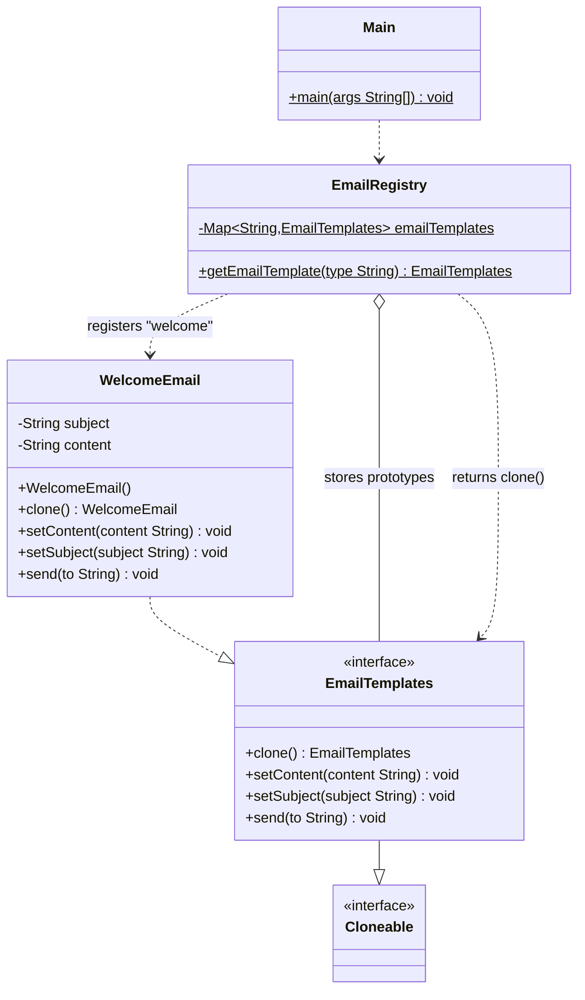

# Prototype Pattern
> Create new objects by cloning an existing one instead of building from scratch.

**Category:** Creational &nbsp;|&nbsp; **My example:** Email templates (Welcome, Forgot-password ...) &nbsp;|&nbsp; [Back to main README](../../../README.md) &nbsp;|&nbsp; [Introduction](../../../introduction/README.md)

**Intent:** Specify the kinds of objects to create using a prototypical instance, and create new ones by copying it.

## Contents

[Code in this folder](#code-in-this-folder) · [Problem](#the-problem) · [Solution](#the-solution) · [Class diagram](#class-diagram) · [Who plays what](#who-plays-what) · [Pros and cons](#pros-and-cons) · [When to use](#when-to-use-it) · [What I learnt](#what-i-learnt) · [Things to improve in my code](#things-to-improve-in-my-code) · [Interview questions](#possible-interview-questions) · [My notes](#my-handwritten-notes)

## Code in this folder

```text
prototypePattern/
├── problem/
│   ├── concreteClasses/
│   │   └── WelcomeEmail.java
│   ├── interfaces/
│   │   └── EmailTemplate.java
│   └── Main.java
└── prototypePatternExample/
    ├── concreteClasses/
    │   └── WelcomeEmail.java
    ├── interfaces/
    │   └── EmailTemplates.java
    ├── registry/
    │   └── EmailRegistry.java
    └── Main.java
```

- `problem/` - the code *without* the pattern, showing why it hurts (the comments at the top of `Main.java` explain it).
- the `...Example/` folder - the same requirement solved *with* the pattern.
- `diagrams/` - Mermaid class diagrams (Lucidchart-ready). `notes/` - photos of my handwritten notes.

## The problem

To send an email from a template you create a `WelcomeEmail`. For a *Forgot Password* email you would have to create another object from scratch again
(in real apps that can mean DB calls or heavy setup). A Singleton looks tempting but is **global**: changing it for Forgot Password would overwrite the Welcome template for everyone.

## The solution

Keep one ready-made object (the **prototype**) in a registry and hand out **clones**:
`EmailRegistry.getEmailTemplate("welcome")` returns `prototype.clone()`.
Each clone is independent - changing its subject/content never affects the original or other clones.
`EmailTemplates` extends `Cloneable` and declares `clone()`; `WelcomeEmail` implements it with `super.clone()`.

## Class diagram

> **Lucidchart:** copy the code block (or open the matching file in [`diagrams/`](diagrams/)), open a new Lucidchart document, choose **Diagram as code** (the `</>` icon), paste it and Lucidchart builds the class diagram. Details are in the [main README](../../../README.md#class-diagrams-and-lucidchart). GitHub also renders the same block as a diagram.



*Your notes call the registry `EmailTemplateRegistry`; in code it is `EmailRegistry`.*

Legend: `..|>` implements - `--|>` extends - `..>` depends on / creates - `-->` association - `o--` aggregation - `*--` composition. `+` public, `-` private, `#` protected, `~` package, `$` static, `*` abstract.

### Who plays what

| Role in the pattern | Class in my code |
|---|---|
| Prototype (interface) | `EmailTemplates` |
| Concrete prototype | `WelcomeEmail` |
| Registry | `EmailRegistry` |
| Client | `Main` |

## Pros and cons

**Pros**

- Faster object creation
- Reduces subclassing
- Runtime object configuration
- Great for UI/UX cloning

**Cons**

- Deep cloning can be hard
- Difficult with circular references
- Might introduce bugs

## When to use it

**Use it when**

- Object creation is expensive (DB calls, heavy computation)
- A system should be independent of how its products are created
- You need many similar objects with slight modifications

**Avoid it when**

- Objects are cheap to create, or hold resources (sockets, threads) that can't be copied

**Real-world examples**

- Template systems (email, documents)
- UI element cloning
- Game objects / configuration presets

## What I learnt

- Prototype is a **creational** pattern used when creating an object is costly or time-consuming and we want to **clone** instead of creating from scratch.
- **Shallow clone** copies only the *references* to inner objects - if those are mutable and shared, the original and the clone affect each other. **Deep clone** copies everything recursively - safer but heavier.
- Why not Singleton here? A Singleton is one shared object, so changing it changes it for everybody. Prototype gives each caller its own copy.
- The registry keeps prototypes by name (`"welcome"`) and returns a *clone* each time, never the stored object itself.
- `super.clone()` is shallow. That's fine now (only `String` fields, which are immutable) but any `List`/`Date` field must be copied manually inside `clone()`.

## Things to improve in my code

Small things I noticed while reviewing the examples - good practice for spotting issues in an interview too:

- `Main` imports `problem.interfaces.EmailTemplate` (from the other package) and never uses it - remove it.
- `emailTemplate2.equals(emailTemplate)` prints `false` only because `equals` isn't overridden (reference equality). To *show* independence, print each object's subject/content after changing one.
- `emailTemplate.send(...)` is called **before** `setContent`/`setSubject`, so the first email still has the default text.
- `Cloneable`/`clone()` is awkward in Java (protected `Object.clone()`, no constructor call). A **copy constructor** or copy factory is often preferred in practice.

## Possible interview questions

Click a question to see a short answer.

<details>
<summary><b>1. What is the Prototype pattern and why use it?</b></summary>

It creates new objects by cloning a prototype. It is useful when construction is expensive or when you want many similar objects with small differences.

</details>

<details>
<summary><b>2. Shallow copy vs deep copy?</b></summary>

Shallow copies the object but shares references to inner objects; deep copy recursively copies inner objects so the clone is fully independent.

</details>

<details>
<summary><b>3. Why not use Singleton for the email templates?</b></summary>

Singleton shares one mutable instance globally; changing it for one use-case would leak into all others. Prototype gives independent copies.

</details>

<details>
<summary><b>4. How does `clone()` work in Java and what are the pitfalls?</b></summary>

Implement `Cloneable` and call `super.clone()`, which makes a field-by-field (shallow) copy without calling a constructor. Pitfalls: checked exception, shallow by default, trouble with `final` and mutable fields, subclass issues.

</details>

<details>
<summary><b>5. What are alternatives to `Cloneable`?</b></summary>

Copy constructors, static copy factories, serialization-based deep copy, or libraries/records with `with`-style copies.

</details>

<details>
<summary><b>6. What does the registry add?</b></summary>

A central place that stores named prototypes and returns clones, so clients don't know or care about concrete classes.

</details>

<details>
<summary><b>7. Prototype vs Factory?</b></summary>

Factory creates a new object from a class (`new`). Prototype copies an existing configured object.

</details>

<details>
<summary><b>8. Problems with circular references?</b></summary>

A naive deep clone loops forever; you need to track already-copied objects or redesign the object graph.

</details>

