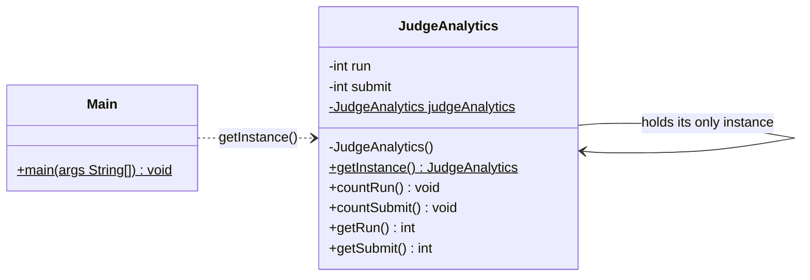
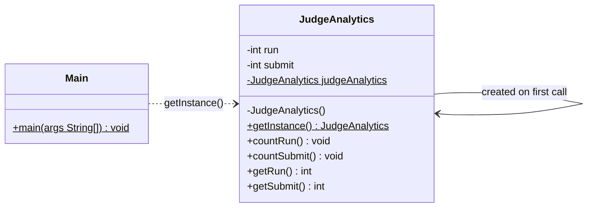
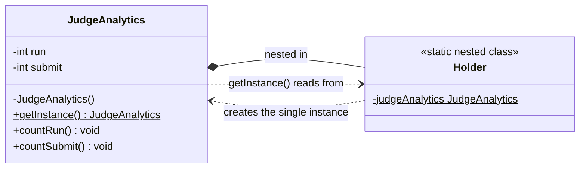

# Singleton Pattern
> Exactly one instance of a class for the whole application, with one global access point.

**Category:** Creational &nbsp;|&nbsp; **My example:** Online judge analytics (counting Run / Submit clicks) &nbsp;|&nbsp; [Back to main README](../../../README.md) &nbsp;|&nbsp; [Introduction](../../../introduction/README.md)

**Intent:** Guarantee that a class has only one instance and give everyone the same access point to it.

## Contents

[Code in this folder](#code-in-this-folder) · [Problem](#the-problem) · [Solution](#the-solution) · [Class diagram](#class-diagram) · [Who plays what](#who-plays-what) · [Pros and cons](#pros-and-cons) · [When to use](#when-to-use-it) · [What I learnt](#what-i-learnt) · [Things to improve in my code](#things-to-improve-in-my-code) · [Interview questions](#possible-interview-questions) · [My notes](#my-handwritten-notes)

## Code in this folder

```text
singletonPattern/
├── problem/
│   ├── JudgeAnalytics.java
│   └── SingletonPattern.java
└── singletonPatternExample/
    ├── eagerLoading/
    │   ├── JudgeAnalytics.java
    │   └── Main.java
    └── lazyLoading/
        ├── JudgeAnalytics.java
        └── Main.java
```

- `problem/` - the code *without* the pattern, showing why it hurts (the comments at the top of `Main.java` explain it).
- the `...Example/` folder - the same requirement solved *with* the pattern.
- `diagrams/` - Mermaid class diagrams (Lucidchart-ready). `notes/` - photos of my handwritten notes.

## The problem

You are building an online compiler and want to count how many times **Run** and **Submit** are clicked.
The IDE section and the Compiler section each do `new JudgeAnalytics()`. Every `new` gives a *separate* object with its *own*
counters, so after one click in each service both objects report `1` instead of a combined `2` (and their hash codes differ).

## The solution

Make the constructor `private`, keep the instance in a `static` field and hand it out through `getInstance()`.
Everyone now shares the same object, so the counters add up (`2` and `2`).

Two ways to create the instance - this is the core of the topic:

| | Eager loading | Lazy loading |
|---|---|---|
| When is it created? | When the class is loaded | The first time `getInstance()` is called |
| Thread-safe? | Yes (the JVM guarantees class initialisation happens once) | **No** in the basic version |
| Wastes memory if never used? | Yes | No |

Lazy + thread-safe has three options (all are in the comments of `lazyLoading/JudgeAnalytics.java`):
1. `synchronized` method - correct but slow (every call takes the lock).
2. **Double-checked locking** - `volatile` field + a `synchronized` block only when the instance is still `null`.
3. **Bill Pugh singleton** - a `private static` inner `Holder` class that owns the instance; it is loaded only on first use.

## Class diagram

> **Lucidchart:** copy the code block (or open the matching file in [`diagrams/`](diagrams/)), open a new Lucidchart document, choose **Diagram as code** (the `</>` icon), paste it and Lucidchart builds the class diagram. Details are in the [main README](../../../README.md#class-diagrams-and-lucidchart). GitHub also renders the same block as a diagram.

### Eager loading



*`private static final` field is initialised when the class loads.*

### Lazy loading



*The field starts as `null`; `getInstance()` creates the object if needed (add `synchronized` / double-checked locking for thread safety).*

### Bill Pugh variant (from your commented code)



*The instance lives in `Holder`, which the JVM loads only when `getInstance()` first touches it.*

Legend: `..|>` implements - `--|>` extends - `..>` depends on / creates - `-->` association - `o--` aggregation - `*--` composition. `+` public, `-` private, `#` protected, `~` package, `$` static, `*` abstract.

### Who plays what

| Role in the pattern | Class in my code |
|---|---|
| Singleton | `JudgeAnalytics` (eager / lazy) |
| Client | `Main` (stands in for the IDE and Compiler services) |

## Pros and cons

**Pros**

- Clean implementation
- Guarantees exactly one instance
- Gives a way to maintain a global resource
- Supports lazy loading

**Cons**

- Often used with parameters and then confused with the Factory pattern
- Hard to write unit tests
- Classes that use it become tightly coupled to it
- Needs special care to avoid race conditions
- Violates the Single Responsibility Principle (controls its own creation *and* does its job)

## When to use it

**Use it when**

- A resource must exist only once because of global state, resource constraints or logical reasons
- It must be reachable from different parts of the system (analytics, login, database access)

**Avoid it when**

- When you need to unit-test the class in isolation or run several independent copies

**Real-world examples**

- Database connection / connection pool
- Login / session manager
- Analytics, logging, configuration

## What I learnt

- Singleton is a **creational** pattern: it solves a problem around *how an object is created*.
- The bug in the `problem` folder is easy to demonstrate: two `new` calls = two objects = two separate counters. Printing the objects shows different hash codes; with Singleton they print the same one.
- **Eager** = instance created when the class loads (thread-safe). **Lazy** = instance created only when needed (basic version is *not* thread-safe).
- If you want thread-safety, eager is the simple answer. If you want lazy *and* thread-safe you have 3 options: `synchronized`, double-checked locking (`volatile` + `synchronized`), or Bill Pugh (inner holder class).
- Why lazy is not thread-safe: two threads can both see `judgeAnalytics == null` at the same time and each create an object.

## Things to improve in my code

Small things I noticed while reviewing the examples - good practice for spotting issues in an interview too:

- The name is **Bill Pugh** (your notes and comments say "Pagh").
- In the double-checked-locking comment, `getInstance()` is declared `synchronized` **and** has a `synchronized` block. Remove `synchronized` from the method signature - otherwise every call still takes the lock and the optimisation is lost.
- The Bill Pugh comment has the `Holder` class but no `getInstance()` that returns `Holder.judgeAnalytics`; add it, and the outer `volatile` field is not needed there.
- In all three `Main` classes the line *"Submit count by object 1"* prints `judgeAnalytics2.getSubmit()` - it should be `judgeAnalytics.getSubmit()`.
- `run++` / `submit++` are not atomic. If several threads call them, use `AtomicInteger`.
- Extra: reflection, serialization and `clone()` can break a singleton. A single-element **enum** is the safest Java singleton.

## Possible interview questions

Click a question to see a short answer.

<details>
<summary><b>1. What is the Singleton pattern and when would you use it?</b></summary>

It ensures a class has one instance for the application's lifetime and provides a global access point to it. Use it for things that must exist once: configuration, logging, analytics, connection pool.

</details>

<details>
<summary><b>2. Eager vs lazy initialisation - which is thread-safe?</b></summary>

Eager creates the instance at class-load time, and the JVM guarantees class initialisation is thread-safe. Basic lazy initialisation is not: two threads can both pass the `null` check.

</details>

<details>
<summary><b>3. Explain double-checked locking. Why is `volatile` needed?</b></summary>

Check `null` without a lock, then lock and check again before creating. `volatile` stops instruction reordering, so another thread can never see a reference to a partially constructed object.

</details>

<details>
<summary><b>4. What is the Bill Pugh singleton and why does it work?</b></summary>

The instance is a `static final` field of a private static inner `Holder` class. `Holder` is loaded only when `getInstance()` is first called, and class loading is thread-safe, so you get lazy + thread-safe with no locking.

</details>

<details>
<summary><b>5. How can a Singleton be broken, and how do you prevent it?</b></summary>

Reflection (calling the private constructor), serialization (new instance on deserialize), `clone()`, multiple class loaders. Prevent with a guard in the constructor, `readResolve()`, or by using an enum singleton.

</details>

<details>
<summary><b>6. What are the drawbacks of Singleton?</b></summary>

Global state, hidden dependencies, tight coupling, hard to mock in unit tests, and it breaks SRP because the class manages its own lifecycle.

</details>

<details>
<summary><b>7. Singleton vs a class with only static methods?</b></summary>

A singleton is a real object: it can implement interfaces, be passed around, lazily initialised and mocked. A static utility class cannot.

</details>

<details>
<summary><b>8. Is a Spring `@Component` bean (default scope) the same as the GoF Singleton?</b></summary>

No. Spring creates one instance *per container*, not one per JVM/class loader, and the class itself is a normal class with a public constructor.

</details>

<details>
<summary><b>9. How would you make `countRun()` safe for many threads?</b></summary>

Use `AtomicInteger` (or `synchronized`) for the counters; making `getInstance()` safe does not make the object's own state safe.

</details>

