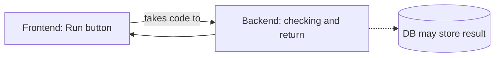
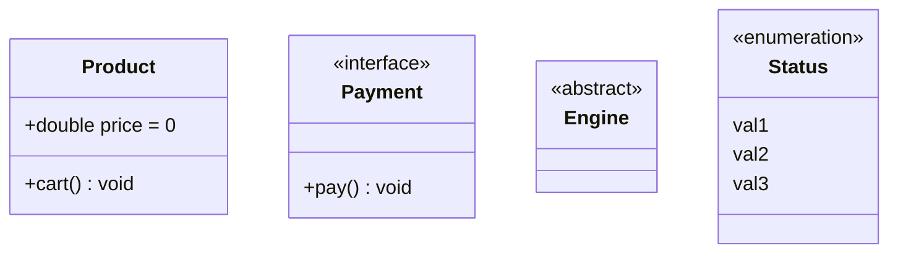
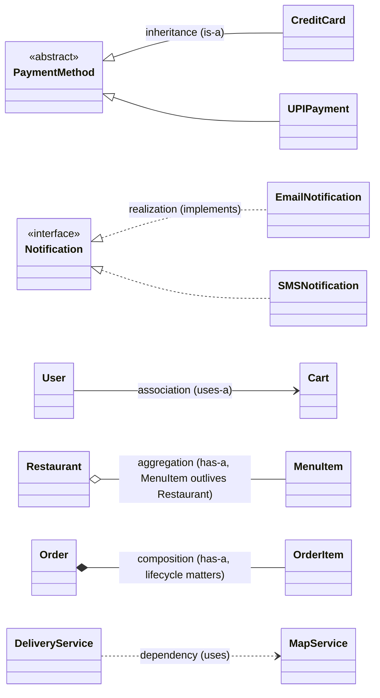

# Introduction to Low-Level Design
> **Prerequisite:** Object-Oriented Programming &nbsp;|&nbsp; **For whom:** SDE interview preparation &nbsp;|&nbsp; **Language:** Java &nbsp;|&nbsp; **What after this:** design more systems on your own

[Back to main README](../../README.md)

## Contents

1. [What is Low-Level Design?](#1-what-is-low-level-design)
2. [HLD vs LLD](#2-hld-vs-lld)
3. [Stakeholders](#3-who-are-the-stakeholders)
4. [Why LLD is important](#4-why-lld-is-important)
5. [Principles of software design: DRY, KISS, YAGNI](#5-principles-of-software-design)
6. [SOLID principles](#6-solid-principles)
7. [UML](#7-unified-modeling-language-uml)
8. [UML class diagrams](#8-uml-class-diagrams)
9. [Relationships between classes](#9-relationships-between-classes)
10. [Introduction to design patterns](#10-introduction-to-design-patterns)
11. [What I learnt](#11-what-i-learnt)
12. [Possible interview questions](#12-possible-interview-questions)
13. [My handwritten notes](#13-my-handwritten-notes)

## 1. What is Low-Level Design?

LLD is where your code starts to take shape. It is the **bridge between architecture and actual implementation**.

**Key characteristics**

1. Granular and code level.
2. Implementation focused.
3. Applies Object-Oriented Programming principles.

## 2. HLD vs LLD

Example: an **online coding editor**.

| | HLD (the big picture) | LLD (every detail) |
|---|---|---|
| Looks like | Frontend (Run button) sends code to the backend; backend checks and returns the result; it may be stored in a DB | Inside the backend: `class Run { variables; methods }`, `class Judge / Execution { variables; methods }` |
| Level | Components and how they communicate | Classes, attributes, methods, relationships |

## 3. Who are the stakeholders?

1. Senior-most members / architecture team - they own the design.
2. As a fresher we are mostly **allowed to implement that design** - but in interviews you are asked to *produce* it.

## 4. Why LLD is important

1. Avoids rework
2. Improves collaboration
3. Promotes scalability
4. Encourages best practices

## 5. Principles of software design

These principles are unavoidable: **DRY**, **KISS**, **YAGNI**.

### DRY - Don't Repeat Yourself

Each piece of knowledge or logic should have a **single, unambiguous representation** within the system.

- *Importance:* reduces redundancy, easier maintenance, single point of change.
- *How to apply:* identify repetitive code, extract common functionality, leverage libraries and frameworks, refactor code regularly.
- *When not to use:* premature abstraction, performance-critical code, when it sacrifices readability, legacy code.

### KISS - Keep It Simple, Stupid

A design should be kept as simple as possible. Complexity should only be introduced when absolutely necessary.

- *Importance:* easier debugging, improved readability, better maintainability, faster development.

### YAGNI - You Aren't Gonna Need It

Always implement things when you **actually need them**, never when you just foresee that you might need them.

- *Importance:* reduced waste, simplified codebase, faster development.
- *When not to follow:* well-known requirements, performance-critical areas.

## 6. SOLID principles

| Letter | Principle | One-line meaning |
|---|---|---|
| S | Single Responsibility (SRP) | A class should have only one reason to change |
| O | Open/Closed (OCP) | Open for extension, closed for modification |
| L | Liskov Substitution (LSP) | Subtypes must be usable wherever the base type is expected |
| I | Interface Segregation (ISP) | Prefer small, specific interfaces over one fat interface |
| D | Dependency Inversion (DIP) | Depend on abstractions, not on concrete low-level classes |

### S - Single Responsibility Principle

1. A class should have only **one reason to change** - one job, one responsibility, one purpose.
2. If a class takes more than one responsibility, those responsibilities are coupled, and a change to one might break the other.

**Why SRP matters - online compiler example:** add driver code -> syntax processing -> run the code with test cases -> store the output in the DB -> return the necessary things. A **coordinator** coordinates all these modules.

- *Benefits:* improved maintainability, better test coverage, lower risk in changes, reusable modules.
- *Common mistakes:* putting DB logic and business logic in the same class; UI code coupled with logic.
- *Is SRP just for classes?* No - it is defined by you: it can be classes, functions, even microservices.

### O - Open/Closed Principle

Software entities (classes, modules, functions) should be **open for extension but closed for modification**: you should be able to add new behaviour without changing existing code.

- *Apply when:* business rules are likely to change or expand; you are building a plug-in system; your codebase is becoming a "God class" with lots of conditionals.
- *Misconceptions:* OCP means never touching old code; it leads to more classes so it is overkill; it makes code harder to read.

### L - Liskov Substitution Principle

If S is a subtype of T, then objects of T may be replaced with objects of S without altering any desirable property of the program.

- *Why it matters (if not followed):* broken functionality when a subclass replaces behaviour; fragile inheritance hierarchies; hard-to-detect bugs; client code coupled to specific types.
- *Spotting violations:* subclasses throwing unexpected exceptions for base-class methods; a subclass changing behaviour so much that the code fails.

### I - Interface Segregation Principle

Clients should not be forced to depend on interfaces they don't use. Don't create large, bloated interfaces - break them into smaller and more specific ones.

- *Benefits:* modularity and flexibility, improved testability, prevents accidental implementation of irrelevant methods, easier-to-understand code.
- *Apply when:* an interface does too many things; some classes implementing it throw errors.

### D - Dependency Inversion Principle

1. High-level modules should not depend on low-level modules.
2. Both should depend on abstractions.
3. Abstractions shouldn't depend on details.
4. Details should depend on abstractions.

- *Benefits:* loosely coupled to interfaces, easy to add new implementations, easy unit tests, abstraction controls flow, fully open/closed friendly.

### Other key principles from my notes

1. Design by contract.
2. Avoid over-inheritance, use **composition**.
3. Refactor early.

## 7. Unified Modeling Language (UML)

UML is a **standardised visual language** used to model and document the design of software systems. It offers a set of diagrams to represent different aspects of a system, giving clear communication among stakeholders and helping us understand the design.

There are **14 kinds** of UML diagrams, divided into 2 types:

| Structural diagrams (7) | What it shows |
|---|---|
| Class diagram | Classes, interfaces, relationships |
| Object diagram | Snapshot of objects at a specific point in time |
| Component diagram | Software components and their dependencies |
| Composite structure diagram | Internal structure of a class and collaboration |
| Deployment diagram | Physical deployment of artifacts |
| Package diagram | Organises elements into packages / modules |
| Profile diagram | Custom stereotypes, tagged values, constraints (modelling extensions) |

| Behavioural diagrams (7) | What it shows |
|---|---|
| Use case diagram | System functionality from the user's point of view |
| Activity diagram | Flowchart of operations / process / workflow |
| Sequence diagram | Interaction of objects in a time sequence |
| Communication diagram | Like sequence, but emphasises the objects |
| State machine diagram | Different states of an object and how it transitions |
| Interaction overview diagram | High-level overview of diagrams |
| Timing diagram | Object behaviour with respect to time |

## 8. UML class diagrams

**Why do we need them?** A way to convey the design in the form of a diagram.

**Class representation:** a box with three parts - class name (top), attributes (middle), operations (bottom).

**Visibility markers:** `+` public, `-` private, `#` protected, `~` package-protected.

| Member | Format | Example |
|---|---|---|
| Attribute | `visibility name: type = default` | `+ price: double = 0` (Java: `public double price = 0;`) |
| Method | `visibility name(name: type, ...): returnType` | `+ sum(a: int, b: int): int` |

Stereotypes: `<<interface>>`, `<<abstract>>` (name in italics), `<<enumeration>>`.

**Perspectives of a class diagram**

1. **Business analysts** - *conceptual* perspective (concepts in the domain).
2. **Architects / designers** - *specification* perspective (focus on interfaces of the abstract data types).
3. **Developers** - *implementation* perspective (how classes will implement their interfaces).

## 9. Relationships between classes

| Relationship | Notation | Meaning (from my notes) | My example |
|---|---|---|---|
| Association | solid line with open arrow | "uses-a": one class uses or interacts with another | `User` uses `Cart` |
| Aggregation | line with hollow diamond on the whole | weak "has-a": the contained class exists independently | `Restaurant` has `MenuItem` (even if the restaurant is gone, the item exists) |
| Composition | line with filled diamond on the whole | strong "has-a": the part cannot exist without the whole; destroy the whole and the parts go too | `Order` has `OrderItem` |
| Inheritance | solid line, hollow triangle | "is-a": a class inherits attributes and methods of another | `CreditCard` / `UPIPayment` extend abstract `PaymentMethod` |
| Realization (implementation) | dashed line, hollow triangle | a class implements the methods declared in an interface | `EmailNotification` / `SMSNotification` implement `Notification` |
| Dependency | dashed open arrow | "uses": a change in one class may affect the other | `DeliveryService` uses `MapService` |

**Most used:** aggregation, association, inheritance, implementation.

## 10. Introduction to design patterns

Design patterns are **proven solutions to recurring design problems** in development. They are not code - rather, practices shaped into **reusable abstractions**.

**Types of design patterns (GoF - 23):** Creational (5), Structural (7), Behavioural (11).

| Category | Focus | Patterns | Status in this repo |
|---|---|---|---|
| Creational | object-creation mechanisms | Singleton, Factory, Abstract Factory, Builder, Prototype | all 5 done |
| Structural | how classes and objects are composed into larger layered structures; makes incompatible interfaces work together | Adapter, Bridge, Composite, Decorator, Facade, Flyweight, Proxy | all 7 done |
| Behavioural | communication between objects | Chain of Responsibility, Command, Interpreter, Iterator, Mediator, Memento, Observer, State, Strategy, Visitor *(+ Template Method, the 11th)* | coming next |

## 11. What I learnt

- LLD is **code-level** design: classes, interfaces, methods and how they relate - the step between the architecture diagram and the real implementation.
- HLD shows *what talks to what*; LLD shows *what is inside each box*.
- DRY, KISS and YAGNI are the everyday habits; each one also has a "when **not** to apply" - blindly applying them is a mistake too.
- SOLID in my own words: one reason to change (S), extend without editing (O), subtypes must behave like their base (L), small interfaces (I), depend on abstractions (D).
- Composition over inheritance, design by contract and early refactoring are the principles behind most design patterns.
- UML class diagram basics: three-part box, visibility markers (`+ - # ~`), `visibility name: type = default` for attributes, `visibility name(params): returnType` for methods, stereotypes for interface/abstract/enum.
- Six relationships and how to tell them apart: association, aggregation, composition, inheritance, realization, dependency.
- Design patterns are proven *practices*, not code; the GoF catalogue has 23 of them in three families.

## 12. Possible interview questions

Click a question to see a short answer.

<b>1. What is Low-Level Design? How is it different from High-Level Design?</b>

HLD is the architecture view: major components and how they talk (frontend -> backend -> database). LLD is where code starts to take shape: classes, interfaces, attributes, methods and relationships inside one component. LLD is the bridge between architecture and actual implementation.

<b>2. Give an example of HLD vs LLD.</b>

Online coding editor. HLD: a frontend with a Run button sends code to a backend that checks it and returns the result (maybe storing it in a DB). LLD: inside the backend, classes such as `Run` and `Judge/Execution` with their variables and methods.

<b>3. What do interviewers expect in an LLD round?</b>

Clarify requirements, identify classes and relationships, apply OOP and SOLID, choose suitable design patterns, draw a class diagram and write clean code for the core flow.

<b>4. Explain DRY. When should you NOT apply it?</b>

Every piece of knowledge/logic should have a single, unambiguous representation. Avoid it for premature abstraction, performance-critical code, when it hurts readability, and sometimes in legacy code.

<b>5. What is KISS?</b>

Keep It Simple, Stupid: a design should be as simple as possible; add complexity only when absolutely necessary. It gives easier debugging, readability, maintainability and faster development.

<b>6. What is YAGNI?</b>

You Aren't Gonna Need It: implement things when you actually need them, not when you foresee you might. It reduces waste and simplifies the codebase. Don't follow it blindly for well-known requirements or performance-critical areas.

<b>7. Explain the Single Responsibility Principle with an example.</b>

A class should have one reason to change. In an online compiler, separate classes for adding driver code, syntax processing, running test cases, storing output in the DB and returning results, plus a coordinator that orchestrates them. Mixing DB logic with business logic is a common violation.

<b>8. What is the Open/Closed Principle and a common misconception?</b>

Software entities should be open for extension but closed for modification: add behaviour without changing existing code. Misconceptions: it means never touching old code; it always creates too many classes; it makes code harder to read.

<b>9. Explain the Liskov Substitution Principle and how to spot violations.</b>

If S is a subtype of T, objects of T can be replaced with objects of S without breaking the program. Violations: subclasses throwing unexpected exceptions for base-class methods, or changing behaviour so much that client code fails or needs `instanceof` checks.

<b>10. What is the Interface Segregation Principle?</b>

Clients shouldn't be forced to depend on interfaces they don't use. Split large interfaces into smaller, specific ones. Apply it when an interface does too many things or implementers throw errors for methods they can't support.

<b>11. What is the Dependency Inversion Principle? Is it the same as dependency injection?</b>

High-level modules should not depend on low-level modules; both should depend on abstractions. Dependency injection is one *technique* for supplying those abstractions from the outside; DIP is the *principle*.

<b>12. Why prefer composition over inheritance?</b>

Composition is flexible (change behaviour at runtime), avoids fragile hierarchies and class explosion, and supports LSP/OCP. Patterns like Decorator, Bridge and Strategy are built on it.

<b>13. What is UML and how many diagram types are there?</b>

A standard visual language for modelling and documenting software design. 14 diagrams: 7 structural (class, object, component, composite structure, deployment, package, profile) and 7 behavioural (use case, activity, sequence, communication, state machine, interaction overview, timing).

<b>14. Explain the visibility markers in a class diagram.</b>

`+` public, `-` private, `#` protected, `~` package-protected.

<b>15. Association vs aggregation vs composition?</b>

Association: 'uses-a'. Aggregation: weak 'has-a' - the part can exist without the whole (Restaurant-MenuItem). Composition: strong 'has-a' - the part is destroyed with the whole (Order-OrderItem).

<b>16. Inheritance vs realization vs dependency?</b>

Inheritance: 'is-a' (class extends class, solid line, hollow triangle). Realization: a class implements an interface (dashed line, hollow triangle). Dependency: 'uses' - a change in one class may affect the other (dashed arrow).

<b>17. What are design patterns? How many are there?</b>

Proven, reusable solutions to recurring design problems - practices shaped into reusable abstractions, not ready-made code. The Gang of Four catalogue has 23: 5 creational, 7 structural, 11 behavioural.

<b>18. What is an anti-pattern? Name one from your notes.</b>

A common but counter-productive solution. Example: the telescoping constructor (many overloaded constructors) which the Builder pattern replaces.

