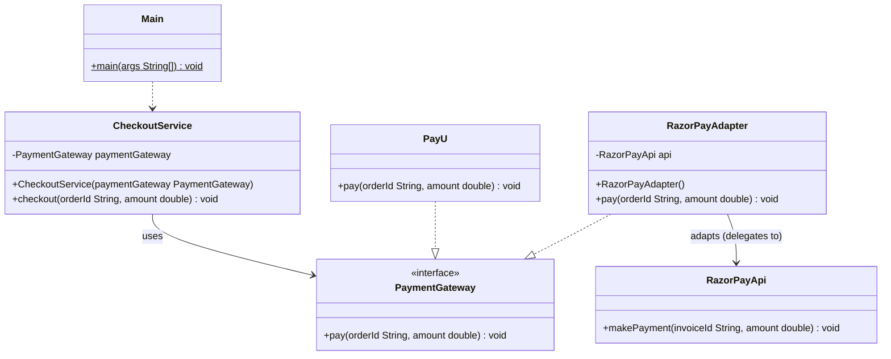

# Adapter Pattern
> Make two incompatible interfaces work together by putting a translator between them.

**Category:** Structural &nbsp;|&nbsp; **My example:** Payment gateways - PayU vs the third-party RazorPay API &nbsp;|&nbsp; [Back to main README](../../../README.md) &nbsp;|&nbsp; [Introduction](../../../introduction/README.md)

**Intent:** Convert the interface of an existing class into the interface the client expects.

## Contents

[Code in this folder](#code-in-this-folder) · [Problem](#the-problem) · [Solution](#the-solution) · [Class diagram](#class-diagram) · [Who plays what](#who-plays-what) · [Pros and cons](#pros-and-cons) · [When to use](#when-to-use-it) · [What I learnt](#what-i-learnt) · [Things to improve in my code](#things-to-improve-in-my-code) · [Interview questions](#possible-interview-questions) · [My notes](#my-handwritten-notes)

## Code in this folder

```text
adapterPattern/
├── adapterPatternExample/
│   ├── adapter/
│   │   └── RazorPayAdapter.java
│   ├── api/
│   │   └── RazorPayApi.java
│   ├── concreteClass/
│   │   └── PayU.java
│   ├── interfaces/
│   │   └── PaymentGateway.java
│   ├── service/
│   │   └── CheckoutService.java
│   └── Main.java
└── problem/
    ├── concreteClass/
    │   └── PayU.java
    ├── interfaces/
    │   └── PaymentGateway.java
    ├── service/
    │   └── CheckoutService.java
    └── Main.java
```

- `problem/` - the code *without* the pattern, showing why it hurts (the comments at the top of `Main.java` explain it).
- the `...Example/` folder - the same requirement solved *with* the pattern.
- `diagrams/` - Mermaid class diagrams (Lucidchart-ready). `notes/` - photos of my handwritten notes.

## The problem

`CheckoutService` works with the `PaymentGateway` interface (`pay(orderId, amount)`) and `PayU` implements it - everything is fine.
The trouble starts when you integrate a **third-party** API such as `RazorPayApi`, whose method is `makePayment(invoiceId, amount)`.
You can't (and shouldn't) edit the library, and you don't want to change `CheckoutService` either.

## The solution

Write `RazorPayAdapter` that **implements `PaymentGateway`** and holds a `RazorPayApi`. Its `pay(...)` simply calls `api.makePayment(...)`.
`CheckoutService` is handed either `new PayU()` or `new RazorPayAdapter()` and can't tell the difference.

## Class diagram

> **Lucidchart:** copy the code block (or open the matching file in [`diagrams/`](diagrams/)), open a new Lucidchart document, choose **Diagram as code** (the `</>` icon), paste it and Lucidchart builds the class diagram. Details are in the [main README](../../../README.md#class-diagrams-and-lucidchart). GitHub also renders the same block as a diagram.



*Same structure as the diagram in your notes: `Main -> CheckoutService -> PaymentGateway <- PayU / RazorPayAdapter -> RazorPayApi`.*

Legend: `..|>` implements - `--|>` extends - `..>` depends on / creates - `-->` association - `o--` aggregation - `*--` composition. `+` public, `-` private, `#` protected, `~` package, `$` static, `*` abstract.

### Who plays what

| Role in the pattern | Class in my code |
|---|---|
| Target (interface the client wants) | `PaymentGateway` |
| Client | `CheckoutService` |
| Adaptee (incompatible class) | `RazorPayApi` |
| Adapter | `RazorPayAdapter` |

## Pros and cons

**Pros**

- Reuse code
- Code extensibility
- Minimises changes to client code
- Helps with integrating third-party code

**Cons**

- Adds an extra layer of abstraction
- Can lead to overuse of adapters, making the system harder to understand

## When to use it

**Use it when**

- You want to use an existing class but its interface doesn't match what you need
- You want to reuse legacy code without modifying it
- You are integrating third-party APIs or external services

**Avoid it when**

- You control both sides and can simply change one interface

**Real-world examples**

- Login frameworks
- Cloud providers
- Payment gateways

## What I learnt

- **Structural patterns** focus on how classes and objects are composed to form larger components.
- Adapter is a structural pattern that lets two incompatible interfaces work together - it acts as a **bridge between the interface a client expects and the actual interface of an existing class**.
- It is especially useful with 3rd-party APIs: make it *common for all*.
- Mechanically: create an adapter class, make it implement the interface, and inside translate the call to the other API.
- The existing code (`CheckoutService`, `PayU`) stays untouched - OCP in action.

## Things to improve in my code

Small things I noticed while reviewing the examples - good practice for spotting issues in an interview too:

- `RazorPayAdapter` creates its own `new RazorPayApi()`. Pass the API in through the constructor so it can be replaced/mocked in tests.
- Real gateways differ in more than names (units, currency, async results, exceptions). Real adapters also translate **data and errors**, not only method names.

## Possible interview questions

Click a question to see a short answer.

<details>
<summary><b>1. What is the Adapter pattern?</b></summary>

A structural pattern that wraps an incompatible class and exposes the interface the client expects, so the two can work together without changing either.

</details>

<details>
<summary><b>2. Class adapter vs object adapter?</b></summary>

Class adapter uses inheritance (extends the adaptee); object adapter uses composition (holds the adaptee). Java has no multiple class inheritance, so object adapters (like `RazorPayAdapter`) are the norm.

</details>

<details>
<summary><b>3. Adapter vs Facade?</b></summary>

Adapter makes *one* interface look like another; Facade provides a *simpler* interface to a whole subsystem.

</details>

<details>
<summary><b>4. Adapter vs Decorator vs Proxy?</b></summary>

All wrap an object. Adapter *changes* the interface; Decorator keeps it and *adds behaviour*; Proxy keeps it and *controls access*.

</details>

<details>
<summary><b>5. Adapter vs Bridge?</b></summary>

Adapter is applied after the fact to make existing, incompatible classes work together. Bridge is designed up front to let abstraction and implementation vary independently.

</details>

<details>
<summary><b>6. Give JDK examples.</b></summary>

`Arrays.asList()` (array -> List), `InputStreamReader` (InputStream -> Reader), `Collections.enumeration()`.

</details>

<details>
<summary><b>7. Which SOLID principles does it support?</b></summary>

OCP (add new gateways without changing the service), SRP (conversion logic is isolated), DIP (client depends on the interface).

</details>

<details>
<summary><b>8. When would you avoid it?</b></summary>

When you can change the original interface directly, or when too many adapters pile up and hide the real design.

</details>


