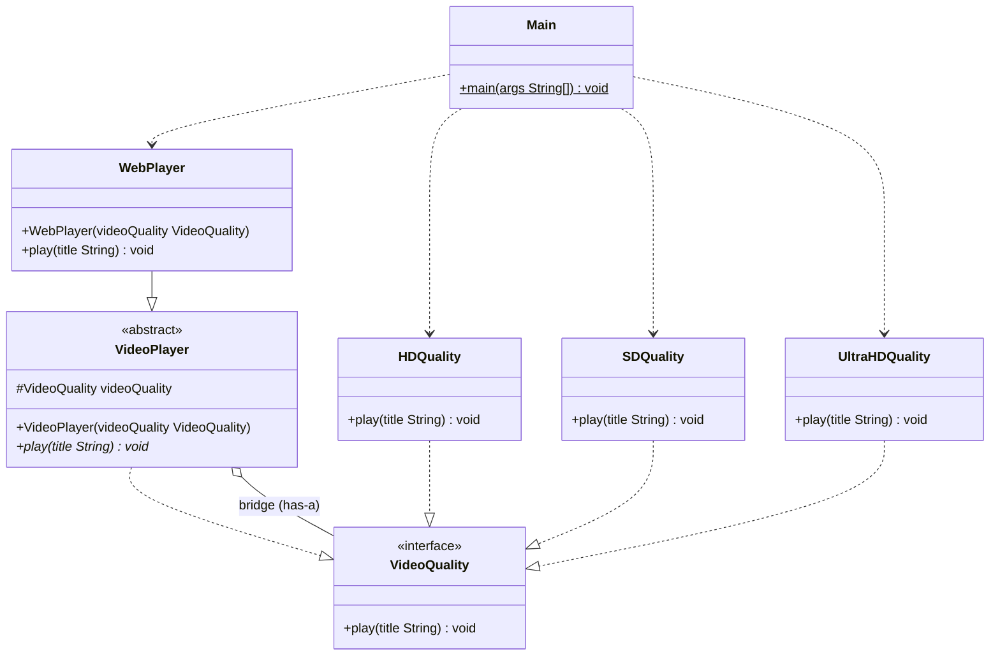

# Bridge Pattern
> Split a class into two hierarchies - abstraction and implementation - so each can change on its own.

**Category:** Structural &nbsp;|&nbsp; **My example:** YouTube-like video player: device x video quality &nbsp;|&nbsp; [Back to main README](../../../README.md) &nbsp;|&nbsp; [Introduction](../../../introduction/README.md)

**Intent:** Decouple an abstraction from its implementation so the two can vary independently.

## Contents

[Code in this folder](#code-in-this-folder) · [Problem](#the-problem) · [Solution](#the-solution) · [Class diagram](#class-diagram) · [Who plays what](#who-plays-what) · [Pros and cons](#pros-and-cons) · [When to use](#when-to-use-it) · [What I learnt](#what-i-learnt) · [Things to improve in my code](#things-to-improve-in-my-code) · [Interview questions](#possible-interview-questions) · [My notes](#my-handwritten-notes)

## Code in this folder

```text
bridgePattern/
├── bridgePatternExample/
│   ├── bridge/
│   │   └── VideoPlayer.java
│   ├── concreteClasses/
│   │   ├── HDQuality.java
│   │   ├── SDQuality.java
│   │   └── UltraHDQuality.java
│   ├── interfaces/
│   │   └── VideoQuality.java
│   ├── services/
│   │   └── WebPlayer.java
│   └── Main.java
└── problem/
    ├── concreteClasses/
    │   ├── MobileHD.java
    │   ├── SmartTVHD.java
    │   └── WebHD.java
    ├── interfaces/
    │   └── PlayQuality.java
    └── Main.java
```

- `problem/` - the code *without* the pattern, showing why it hurts (the comments at the top of `Main.java` explain it).
- the `...Example/` folder - the same requirement solved *with* the pattern.
- `diagrams/` - Mermaid class diagrams (Lucidchart-ready). `notes/` - photos of my handwritten notes.

## The problem

A video app supports **HD** on Web, Mobile and SmartTV, so you create `WebHD`, `MobileHD` and `SmartTVHD`.
Now add 4K and 8K: that's 6 more classes. Add a new device and you need one more class *per quality*.
Two dimensions of change (device x quality) multiply the number of classes - **class explosion**.

## The solution

Separate the two dimensions:
* **Implementation side**: `VideoQuality` interface -> `HDQuality`, `SDQuality`, `UltraHDQuality`.
* **Abstraction side**: abstract `VideoPlayer` (the *bridge*) that **holds** a `VideoQuality` -> `WebPlayer` (and later Mobile/SmartTV players).

`new WebPlayer(new HDQuality())` combines any device with any quality. Classes grow as **M + N**, not **M x N**.

## Class diagram

> **Lucidchart:** copy the code block (or open the matching file in [`diagrams/`](diagrams/)), open a new Lucidchart document, choose **Diagram as code** (the `</>` icon), paste it and Lucidchart builds the class diagram. Details are in the [main README](../../../README.md#class-diagrams-and-lucidchart). GitHub also renders the same block as a diagram.



*Your notes also show `MobilePlayer` and `SmartTVPlayer`; they aren't in the code yet but would be two more subclasses of `VideoPlayer` - no change to the quality classes.*

Legend: `..|>` implements - `--|>` extends - `..>` depends on / creates - `-->` association - `o--` aggregation - `*--` composition. `+` public, `-` private, `#` protected, `~` package, `$` static, `*` abstract.

### Who plays what

| Role in the pattern | Class in my code |
|---|---|
| Abstraction | `VideoPlayer` (abstract, holds the bridge) |
| Refined abstraction | `WebPlayer` |
| Implementor (interface) | `VideoQuality` |
| Concrete implementors | `HDQuality`, `SDQuality`, `UltraHDQuality` |

## Pros and cons

**Pros**

- Decouples abstraction and implementation - changes on either side don't affect the other
- Avoids class explosion
- Supports OCP
- Ideal for cross-platform apps
- Improves maintainability and testing

**Cons**

- Increased complexity in small-scale systems
- Can be confused with other patterns
- Coordination needed if separate teams handle each side

## When to use it

**Use it when**

- You have two dimensions of variation
- You want them to evolve independently
- You want to avoid class explosion

**Avoid it when**

- There is only one dimension of variation - plain inheritance or an interface is simpler

**Real-world examples**

- YouTube-style players (device x quality)
- Cross-platform UI (window x OS)
- Drivers / logging backends

## What I learnt

- Bridge is a **structural** pattern that **decouples an abstraction from its implementation** so they can vary independently.
- Spot it when you have **two dimensions** (here: device and quality) that you want to evolve independently and you want to avoid class explosion.
- The 'bridge' is just **composition**: `VideoPlayer` has a `VideoQuality` field, passed in through the constructor.
- With 3 devices and 3 qualities, inheritance needs 9 classes; Bridge needs 3 + 3 = 6 - and the gap grows with every addition.
- Adding 8K = one new `VideoQuality` class. Adding SmartTV = one new `VideoPlayer` subclass. Nothing else changes.

## Things to improve in my code

Small things I noticed while reviewing the examples - good practice for spotting issues in an interview too:

- `VideoPlayer implements VideoQuality`, which makes the *abstraction* and the *implementor* share one interface. In the classic Bridge the abstraction has its **own** operation (e.g. `watch(title)`) that delegates to the implementor. Your version works, but the two hierarchies are more tightly linked than they need to be.
- `WebPlayer.play()` only delegates. A real device player would add device behaviour (screen size, buffering) before/after calling `videoQuality.play(...)`.
- `Main` declares the variables as `VideoQuality`; using `VideoPlayer` makes the intent (a *player* with a quality) clearer.
- The `problem` folder's `Main` is empty - printing the 3 x 3 class count there would make the explosion obvious.
- To match your notes' diagram, add `MobilePlayer` and `SmartTVPlayer`.

## Possible interview questions

Click a question to see a short answer.

<details>
<summary><b>1. What is the Bridge pattern?</b></summary>

A structural pattern that splits a class into an abstraction hierarchy and an implementation hierarchy, linked by composition, so each can change independently.

</details>

<details>
<summary><b>2. What problem does it solve?</b></summary>

Class explosion when a class varies in two independent dimensions (e.g. device x quality: M x N classes become M + N).

</details>

<details>
<summary><b>3. Bridge vs Adapter?</b></summary>

Adapter fixes incompatibility *after* the classes exist. Bridge is planned *up front* so abstraction and implementation can evolve separately.

</details>

<details>
<summary><b>4. Bridge vs Strategy?</b></summary>

Structurally similar (a field holding an interface). Strategy swaps an *algorithm* of one class; Bridge separates a whole *abstraction hierarchy* from an *implementation hierarchy*.

</details>

<details>
<summary><b>5. What do 'abstraction' and 'implementation' mean here?</b></summary>

Not 'abstract class' vs 'class'. The abstraction is the high-level control layer clients use; the implementation is the low-level work it delegates to.

</details>

<details>
<summary><b>6. How do you add a new device or quality?</b></summary>

New device: subclass `VideoPlayer`. New quality: implement `VideoQuality`. Neither touches existing classes.

</details>

<details>
<summary><b>7. Give real examples.</b></summary>

JDBC (`DriverManager` API vs vendor drivers), SLF4J (logging API vs backend), cross-platform GUI toolkits.

</details>

<details>
<summary><b>8. Which principles does it support?</b></summary>

OCP, SRP, composition over inheritance.

</details>


