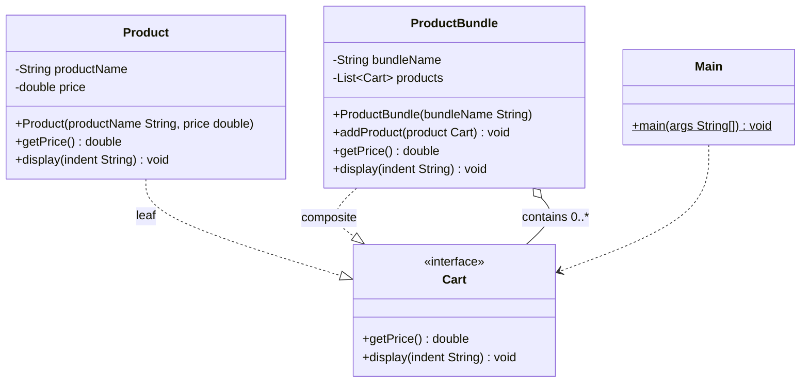

# Composite Pattern
> Treat a single object and a group of objects through the same interface.

**Category:** Structural &nbsp;|&nbsp; **My example:** E-commerce cart: Product and ProductBundle &nbsp;|&nbsp; [Back to main README](../../../README.md) &nbsp;|&nbsp; [Introduction](../../../introduction/README.md)

**Intent:** Compose objects into tree structures and let clients treat individual objects and compositions uniformly.

## Contents

[Code in this folder](#code-in-this-folder) · [Problem](#the-problem) · [Solution](#the-solution) · [Class diagram](#class-diagram) · [Who plays what](#who-plays-what) · [Pros and cons](#pros-and-cons) · [When to use](#when-to-use-it) · [What I learnt](#what-i-learnt) · [Things to improve in my code](#things-to-improve-in-my-code) · [Interview questions](#possible-interview-questions) · [My notes](#my-handwritten-notes)

## Code in this folder

```text
compositePattern/
├── compositePatternExample/
│   ├── interfaces/
│   │   └── Cart.java
│   ├── Main.java
│   ├── Product.java
│   └── ProductBundle.java
└── problem/
    ├── Main.java
    ├── Product.java
    └── ProductBundle.java
```

- `problem/` - the code *without* the pattern, showing why it hurts (the comments at the top of `Main.java` explain it).
- the `...Example/` folder - the same requirement solved *with* the pattern.
- `diagrams/` - Mermaid class diagrams (Lucidchart-ready). `notes/` - photos of my handwritten notes.

## The problem

An e-commerce cart holds single **products** and **bundles** (a bundle contains products). They're two unrelated types, so the cart has to be a `List<Object>`.
To display or total it you need `instanceof` checks and casts for each type - the client knows too much and every new type means more `if` branches.

## The solution

Create a common `Cart` interface (`getPrice()`, `display(indent)`).
* `Product` is a **leaf** - implements `Cart`.
* `ProductBundle` is the **composite** - implements `Cart` *and* holds a `List<Cart>`; its `getPrice()` sums its children, its `display()` prints itself and its children.

Now the cart is a `List<Cart>` and one loop handles products and bundles alike (bundles can even contain other bundles).

## Class diagram

> **Lucidchart:** copy the code block (or open the matching file in [`diagrams/`](diagrams/)), open a new Lucidchart document, choose **Diagram as code** (the `</>` icon), paste it and Lucidchart builds the class diagram. Details are in the [main README](../../../README.md#class-diagrams-and-lucidchart). GitHub also renders the same block as a diagram.



*Matches your notes: `Cart` interface, `Product` (leaf) and `ProductBundle` (composite, aggregation to `Cart`).*

Legend: `..|>` implements - `--|>` extends - `..>` depends on / creates - `-->` association - `o--` aggregation - `*--` composition. `+` public, `-` private, `#` protected, `~` package, `$` static, `*` abstract.

### Who plays what

| Role in the pattern | Class in my code |
|---|---|
| Component | `Cart` |
| Leaf | `Product` |
| Composite | `ProductBundle` |
| Client | `Main` |

## Pros and cons

**Pros**

- Uniformity - treat individual and group the same way
- Extensible (new component types)
- Cleaner client code
- Supports OCP

**Cons**

- Can violate SRP at scale
- Overkill for flat and simple structures
- In a tightly regulated system, uniform treatment can hide important distinctions between item types

## When to use it

**Use it when**

- You have a hierarchical (tree) structure
- You want to treat individual objects and groups the same way
- You want to avoid client-side logic that tells leaf and composite apart

**Avoid it when**

- The structure is flat or there are no groups

**Real-world examples**

- Cart / bundle systems
- Google Drive (files and folders)
- UI component trees, org charts, menus

## What I learnt

- Composite is a **structural** pattern that lets you compose objects into **tree structures** to represent part-whole hierarchies; you can treat a **group of objects like a single object**.
- **Leaf** = `Product`, **Composite** = `ProductBundle`.
- The key trick is the shared interface: `ProductBundle` stores `List<Cart>`, not `List<Product>`, so it can hold products *and* other bundles.
- `getPrice()` and `display()` on a bundle simply loop over children and call the same methods - **recursion** does the tree walking.
- Without the pattern I needed `List<Object>`, `instanceof` and casting - exactly what the `problem` folder shows.

## Things to improve in my code

Small things I noticed while reviewing the examples - good practice for spotting issues in an interview too:

- `Cart` is a good name for the *container*, but here it is the interface for each *item* (leaf or bundle). `CartItem` or `Component` would read more clearly.
- `addProduct` exists only on `ProductBundle` (the *safe* design), so `Main` must keep a `ProductBundle` reference to add items. Putting `add` on the interface is the *transparent* design - know the trade-off.
- Money is stored as `double`. Prefer `BigDecimal` in real e-commerce code.
- No `removeProduct`, and nothing prevents a bundle from being added to itself (cycle).

## Possible interview questions

Click a question to see a short answer.

<details>
<summary><b>1. What is the Composite pattern?</b></summary>

A structural pattern that composes objects into trees and lets clients treat single objects (leaves) and groups (composites) through one interface.

</details>

<details>
<summary><b>2. Who are the leaf and composite in your example?</b></summary>

`Product` is the leaf, `ProductBundle` is the composite, `Cart` is the common component interface.

</details>

<details>
<summary><b>3. Transparent vs safe composite?</b></summary>

Transparent: child-management methods (`add/remove`) are on the component interface (uniform but leaves must reject them). Safe: only the composite has them (type-safe, but the client must know which it holds).

</details>

<details>
<summary><b>4. How does `getPrice()` work on a bundle?</b></summary>

It loops over children and sums their `getPrice()`; if a child is another bundle, the call recurses.

</details>

<details>
<summary><b>5. Composite vs Decorator?</b></summary>

Both rely on recursive composition. Composite holds *many* children and aggregates results; Decorator wraps *one* object to add behaviour.

</details>

<details>
<summary><b>6. Give real examples.</b></summary>

File system (files/folders), Swing/AWT `Container`, DOM tree, organisation charts, menus.

</details>

<details>
<summary><b>7. What problems can arise?</b></summary>

Cycles, performance on very deep trees, hard-to-restrict child types, and hiding differences between leaf and composite.

</details>

<details>
<summary><b>8. Which principles does it follow?</b></summary>

OCP (new component types plug in) and polymorphism; it can strain SRP when the component interface becomes large.

</details>


