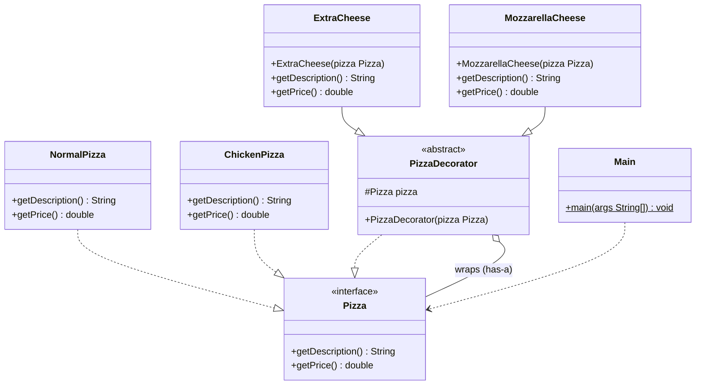

# Decorator Pattern
> Add behaviour to an object at runtime by wrapping it, layer by layer, without changing its class.

**Category:** Structural &nbsp;|&nbsp; **My example:** Pizza ordering - base pizzas + cheese add-ons &nbsp;|&nbsp; [Back to main README](../../../README.md) &nbsp;|&nbsp; [Introduction](../../../introduction/README.md)

**Intent:** Attach additional responsibilities to an object dynamically; a flexible alternative to subclassing.

## Contents

[Code in this folder](#code-in-this-folder) · [Problem](#the-problem) · [Solution](#the-solution) · [Class diagram](#class-diagram) · [Who plays what](#who-plays-what) · [Pros and cons](#pros-and-cons) · [When to use](#when-to-use-it) · [What I learnt](#what-i-learnt) · [Things to improve in my code](#things-to-improve-in-my-code) · [Interview questions](#possible-interview-questions) · [My notes](#my-handwritten-notes)

## Code in this folder

```text
decoratorPattern/
├── decoratorPatternExample/
│   ├── concreteClass/
│   │   ├── ChickenPizza.java
│   │   └── NormalPizza.java
│   ├── concreteDecoratorClass/
│   │   ├── ExtraCheese.java
│   │   └── MozzarellaCheese.java
│   ├── decoratorClass/
│   │   └── PizzaDecorator.java
│   ├── interfaces/
│   │   └── Pizza.java
│   └── Main.java
└── problem/
    └── Main.java
```

- `problem/` - the code *without* the pattern, showing why it hurts (the comments at the top of `Main.java` explain it).
- the `...Example/` folder - the same requirement solved *with* the pattern.
- `diagrams/` - Mermaid class diagrams (Lucidchart-ready). `notes/` - photos of my handwritten notes.

## The problem

A food-delivery app sells pizzas in many varieties: `PlainPizza`, `CheesePizza`, `OlivePizza`, `StuffedPizza`, `CheeseStuffedPizza`, `CheeseOlivePizza` ...
Every combination needs its own subclass - impossible to maintain. **Builder** doesn't fit either: toppings aren't *optional fields* of one object, they are *combinable behaviours*.

## The solution

* `Pizza` interface (`getDescription()`, `getPrice()`).
* Concrete base pizzas: `NormalPizza`, `ChickenPizza`.
* Abstract `PizzaDecorator implements Pizza` **and holds a `Pizza`** (passed through the constructor).
* Concrete decorators `ExtraCheese`, `MozzarellaCheese` extend it; each calls `pizza.getPrice()` / `getDescription()` and adds its own bit.

`new ExtraCheese(new ChickenPizza())` - one object, any combination, decided at runtime. Each decorator is a layer, like wrapping gift boxes.

## Class diagram

> **Lucidchart:** copy the code block (or open the matching file in [`diagrams/`](diagrams/)), open a new Lucidchart document, choose **Diagram as code** (the `</>` icon), paste it and Lucidchart builds the class diagram. Details are in the [main README](../../../README.md#class-diagrams-and-lucidchart). GitHub also renders the same block as a diagram.



*Your notes draw `Olives` and `StuffedCrust` as decorators; in code they are `ExtraCheese` and `MozzarellaCheese`.*

Legend: `..|>` implements - `--|>` extends - `..>` depends on / creates - `-->` association - `o--` aggregation - `*--` composition. `+` public, `-` private, `#` protected, `~` package, `$` static, `*` abstract.

### Who plays what

| Role in the pattern | Class in my code |
|---|---|
| Component | `Pizza` |
| Concrete components | `NormalPizza`, `ChickenPizza` |
| Decorator (base) | `PizzaDecorator` |
| Concrete decorators | `ExtraCheese`, `MozzarellaCheese` |

## Pros and cons

**Pros**

- Follows OCP
- Runtime flexibility - compose features
- Avoids subclass explosion
- Promotes single responsibility for each add-on

**Cons**

- Can result in many small classes
- Stack-trace debugging is difficult
- Overhead of multiple wrapping classes
- Developers must understand the decorator flow

## When to use it

**Use it when**

- You need to add responsibilities dynamically
- You want to avoid an explosion of subclasses
- You want to follow OCP
- You want reusable, composable behaviour / layered step-by-step enhancements

**Avoid it when**

- A fixed, small set of variants where simple subclasses are clearer

**Real-world examples**

- Food delivery app (toppings, add-ons)
- Word / Google Docs formatting (bold, italic ...)
- Java I/O streams (`BufferedReader(new FileReader(...))`)

## What I learnt

- Decorator lets you **add new behaviour to objects dynamically at runtime without modifying their original structure**.
- Abstract classes *can* have constructors - they just run when a subclass is instantiated. `ExtraCheese` passes the `Pizza` up to `PizzaDecorator`'s constructor.
- Each decorator is **a layer, like wrapping gift boxes**, and each one adds behaviour to the one it wraps.
- It works **like a call stack where behaviour accumulates**: `ExtraCheese.getPrice()` calls the wrapped pizza's `getPrice()` and adds its own amount.
- Why not Builder? Builder is for *optional fields* of one class; decorator handles *combinable types/behaviours*.

## Things to improve in my code

Small things I noticed while reviewing the examples - good practice for spotting issues in an interview too:

- `ExtraCheese.getDescription()` returns `... + "with ExtraCheese"` (no separator), while Mozzarella returns `",with Mozzarella Cheese"`. Output reads `Veggie Pizzawith ExtraCheese`. Use the same `", with ..."` format in both.
- `Main` never stacks decorators. Add `new MozzarellaCheese(new ExtraCheese(new ChickenPizza()))` - that is the whole point of the pattern.
- `NormalPizza` returns `"Veggie Pizza"`; `VeggiePizza` would be a clearer class name.
- Prices are `double`; use `BigDecimal` for money.
- My notes call Decorator a "structural behaviour pattern" - it is a **structural** pattern.

## Possible interview questions

Click a question to see a short answer.

<details>
<summary><b>1. What is the Decorator pattern?</b></summary>

A structural pattern that wraps an object with another object implementing the same interface to add behaviour dynamically, without changing the original class.

</details>

<details>
<summary><b>2. Why not just use inheritance?</b></summary>

Inheritance is static and causes subclass explosion for every combination of features; decorators combine behaviours at runtime.

</details>

<details>
<summary><b>3. Decorator vs Builder?</b></summary>

Builder constructs one object with optional fields; Decorator adds stackable behaviours to an existing object.

</details>

<details>
<summary><b>4. Decorator vs Proxy?</b></summary>

Same shape (wrapper with same interface). Decorator *adds* behaviour and is typically assembled by the client; Proxy *controls access* (caching, lazy-load, security).

</details>

<details>
<summary><b>5. Decorator vs Composite?</b></summary>

Composite aggregates many children and combines results; Decorator wraps exactly one object and enhances it.

</details>

<details>
<summary><b>6. Why does `PizzaDecorator` implement `Pizza` and also hold a `Pizza`?</b></summary>

Implementing the interface makes a decorated pizza usable anywhere a pizza is expected; holding a pizza lets it delegate to the wrapped one.

</details>

<details>
<summary><b>7. Where does the JDK use it?</b></summary>

`java.io` streams (`BufferedInputStream`, `DataInputStream`), `Collections.unmodifiableList`, `Collections.synchronizedList`.

</details>

<details>
<summary><b>8. Disadvantages?</b></summary>

Many small classes, order of wrapping can matter, harder debugging, and `instanceof` checks no longer see the underlying type.

</details>

<details>
<summary><b>9. How do you calculate the final price of a 2-layer decorated pizza?</b></summary>

The outer decorator calls the inner one: `outer.getPrice() = inner.getPrice() + outerCost`, down to the base pizza - like a call stack.

</details>


