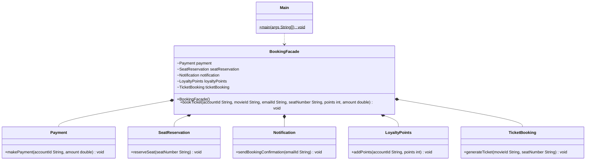

# Facade Pattern
> Give clients one simple entry point to a complicated subsystem.

**Category:** Structural &nbsp;|&nbsp; **My example:** Entertainment ticket booking (movies, stand-up, concerts) &nbsp;|&nbsp; [Back to main README](../../../README.md) &nbsp;|&nbsp; [Introduction](../../../introduction/README.md)

**Intent:** Provide a unified, simplified interface to a set of interfaces in a subsystem.

## Contents

[Code in this folder](#code-in-this-folder) · [Problem](#the-problem) · [Solution](#the-solution) · [Class diagram](#class-diagram) · [Who plays what](#who-plays-what) · [Pros and cons](#pros-and-cons) · [When to use](#when-to-use-it) · [What I learnt](#what-i-learnt) · [Things to improve in my code](#things-to-improve-in-my-code) · [Interview questions](#possible-interview-questions) · [My notes](#my-handwritten-notes)

## Code in this folder

```text
facadePattern/
├── facadePatternExample/
│   ├── facade/
│   │   └── BookingFacade.java
│   ├── ticketBookingProcess/
│   │   ├── LoyaltyPoints.java
│   │   ├── Notification.java
│   │   ├── Payment.java
│   │   ├── SeatReservation.java
│   │   └── TicketBooking.java
│   └── Main.java
└── problem/
    ├── ticketBookingProcess/
    │   ├── LoyaltyPoints.java
    │   ├── Notification.java
    │   ├── Payment.java
    │   ├── SeatReservation.java
    │   └── TicketBooking.java
    └── Main.java
```

- `problem/` - the code *without* the pattern, showing why it hurts (the comments at the top of `Main.java` explain it).
- the `...Example/` folder - the same requirement solved *with* the pattern.
- `diagrams/` - Mermaid class diagrams (Lucidchart-ready). `notes/` - photos of my handwritten notes.

## The problem

Booking a movie ticket means the client must create and call `Payment`, `SeatReservation`, `Notification`, `LoyaltyPoints` and `TicketBooking` - in the right order and with the right constructor arguments.
The app also sells stand-up shows and concerts, so every client repeats this recipe. The client knows far too much about the internals and is tightly coupled to them.

## The solution

Create `BookingFacade`. It owns the subsystem objects and exposes one method, `bookTicket(accountId, movieId, emailId, seatNumber, points, amount)`, which runs the whole process.
The client makes a single call and doesn't care *how* the booking happens. The subsystem classes are unchanged (and can still be used directly when needed).

## Class diagram

> **Lucidchart:** copy the code block (or open the matching file in [`diagrams/`](diagrams/)), open a new Lucidchart document, choose **Diagram as code** (the `</>` icon), paste it and Lucidchart builds the class diagram. Details are in the [main README](../../../README.md#class-diagrams-and-lucidchart). GitHub also renders the same block as a diagram.



*In your notes this is `MovieFacade` with dependency arrows to the five subsystem classes; the code calls it `BookingFacade` and creates them in its constructor.*

Legend: `..|>` implements - `--|>` extends - `..>` depends on / creates - `-->` association - `o--` aggregation - `*--` composition. `+` public, `-` private, `#` protected, `~` package, `$` static, `*` abstract.

### Who plays what

| Role in the pattern | Class in my code |
|---|---|
| Facade | `BookingFacade` |
| Subsystem classes | `Payment`, `SeatReservation`, `Notification`, `LoyaltyPoints`, `TicketBooking` |
| Client | `Main` |

## Pros and cons

**Pros**

- Lightweight coupling
- Flexibility
- Simplifies client design
- Promotes layered architecture
- Better testability

**Cons**

- Fragile coupling
- Hidden complexity
- Runtime errors
- Difficult to trace
- Violation of SRP (a facade can turn into a god class)

## When to use it

**Use it when**

- Subsystems are complex
- You want to provide a simpler API
- You want to reduce coupling between subsystems and client code
- You want to layer your architecture clearly

**Avoid it when**

- The subsystem is already simple, or clients really need fine-grained control over every step

**Real-world examples**

- Booking apps (movie / events)
- Service layer in an MVC app
- API gateway over several microservices

## What I learnt

- Facade is a **structural** pattern that provides a **simplified, unified interface to a set of interfaces in a subsystem**.
- I moved the whole process inside one class and created one method that calls everything, so the client just says *what* it wants, not *how* it is done.
- Because the subsystem objects live in the facade, they no longer need constructor state - values are passed through `bookTicket(...)`.
- A facade **doesn't forbid** access to the subsystem; it just offers an easy path.
- **Expert tip from my notes:** always depend on abstractions (interfaces) rather than concrete classes to minimise tight coupling - that applies to the facade's own dependencies too.

## Things to improve in my code

Small things I noticed while reviewing the examples - good practice for spotting issues in an interview too:

- `BookingFacade` does `new Payment()`, `new SeatReservation()` ... in its constructor, so it is tied to concrete classes - exactly what the expert tip warns against. Introduce interfaces and pass them in.
- The fields are package-private; make them `private final`.
- `bookTicket` has six parameters - a `BookingRequest` object (built with Builder!) would be cleaner.
- No error handling: if seat reservation fails *after* payment succeeded, nothing refunds. Real facades need rollback/compensation.
- Your notes call it `MovieFacade`; keep names consistent across notes, code and diagram.

## Possible interview questions

Click a question to see a short answer.

<details>
<summary><b>1. What is the Facade pattern?</b></summary>

A structural pattern that offers one simple interface to a complex subsystem so clients don't have to coordinate many classes.

</details>

<details>
<summary><b>2. Facade vs Adapter?</b></summary>

Adapter converts one interface into another expected interface; Facade simplifies access to many classes with a new, easier interface.

</details>

<details>
<summary><b>3. Facade vs Mediator?</b></summary>

Facade is a one-way convenience for clients (subsystems don't know it exists). Mediator coordinates two-way communication between peers that know the mediator.

</details>

<details>
<summary><b>4. Does a facade hide the subsystem completely?</b></summary>

No. It is a convenience layer; advanced clients can still use subsystem classes directly.

</details>

<details>
<summary><b>5. What are the risks?</b></summary>

It can grow into a god object with too many responsibilities, hide errors, and add a layer that is hard to trace.

</details>

<details>
<summary><b>6. How would you test `BookingFacade`?</b></summary>

Make it depend on interfaces and inject mocks for payment, seats, notification etc., then verify the call order and arguments.

</details>

<details>
<summary><b>7. Where do you see facades in real projects?</b></summary>

Service classes over several repositories, API gateways, `JdbcTemplate`-style helpers, SDK client classes wrapping many REST calls.

</details>

<details>
<summary><b>8. How do you handle failures across steps in the facade?</b></summary>

Use transactions where possible or compensating actions (refund, release seat) - the saga idea.

</details>


