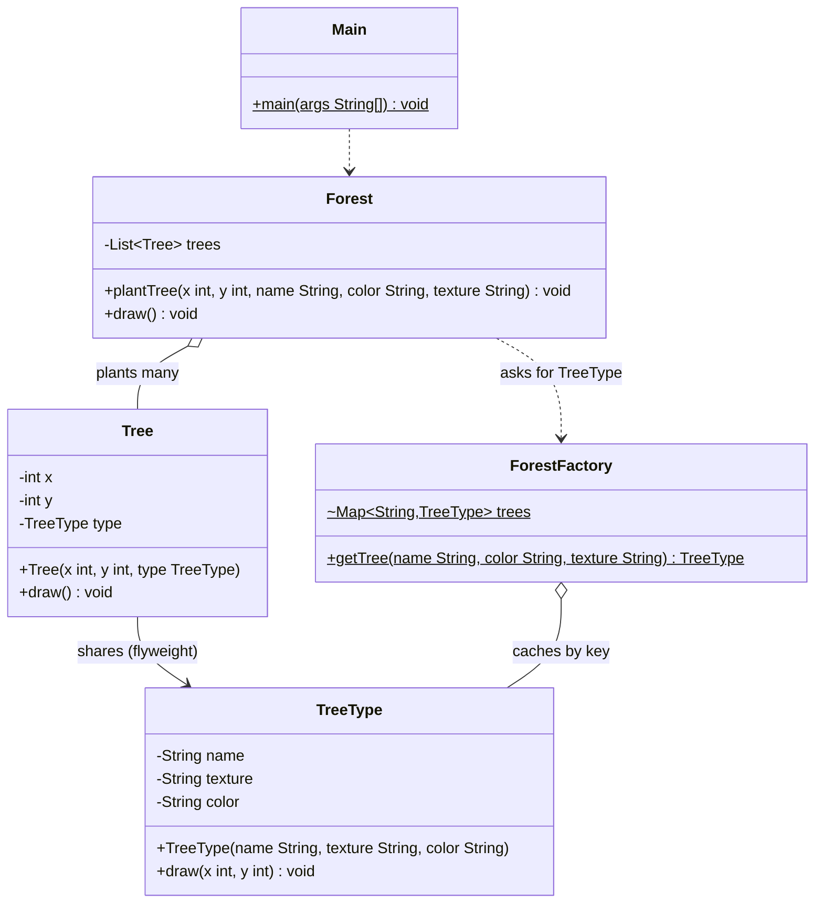

# Flyweight Pattern
> Share the common part of many similar objects to save memory.

**Category:** Structural &nbsp;|&nbsp; **My example:** Google-Maps-style forest with thousands of trees &nbsp;|&nbsp; [Back to main README](../../../README.md) &nbsp;|&nbsp; [Introduction](../../../introduction/README.md)

**Intent:** Use sharing to support large numbers of fine-grained objects efficiently.

## Contents

[Code in this folder](#code-in-this-folder) · [Problem](#the-problem) · [Solution](#the-solution) · [Class diagram](#class-diagram) · [Who plays what](#who-plays-what) · [Pros and cons](#pros-and-cons) · [When to use](#when-to-use-it) · [What I learnt](#what-i-learnt) · [Things to improve in my code](#things-to-improve-in-my-code) · [Interview questions](#possible-interview-questions) · [My notes](#my-handwritten-notes)

## Code in this folder

```text
flyWeightPattern/
├── flyWeightPatternExample/
│   ├── Forest.java
│   ├── ForestFactory.java
│   ├── Main.java
│   ├── Tree.java
│   └── TreeType.java
└── problem/
    ├── Forest.java
    ├── Main.java
    └── Tree.java
```

- `problem/` - the code *without* the pattern, showing why it hurts (the comments at the top of `Main.java` explain it).
- the `...Example/` folder - the same requirement solved *with* the pattern.
- `diagrams/` - Mermaid class diagrams (Lucidchart-ready). `notes/` - photos of my handwritten notes.

## The problem

A maps app draws a forest. Every `Tree` stores its position **and** its `name`, `color` and `texture`.
The map treats all those trees as the same kind, so 1000 trees means 1000 copies of identical data - a huge, pointless memory cost.

## The solution

Split the data into two kinds:
* **Intrinsic** (shared, doesn't change): `name`, `color`, `texture` -> moved into `TreeType`.
* **Extrinsic** (unique, keeps changing): `x`, `y` -> stay in `Tree`.

`ForestFactory.getTree(name, color, texture)` keeps a `Map<String, TreeType>` and returns an existing `TreeType` when the key already exists (**Factory + Flyweight**).
`Forest.plantTree(...)` creates a light `Tree(x, y, sharedType)`. In `Main` about **1,002,001** trees share **one** `TreeType`.

## Class diagram

> **Lucidchart:** copy the code block (or open the matching file in [`diagrams/`](diagrams/)), open a new Lucidchart document, choose **Diagram as code** (the `</>` icon), paste it and Lucidchart builds the class diagram. Details are in the [main README](../../../README.md#class-diagrams-and-lucidchart). GitHub also renders the same block as a diagram.



*In your notes `ForestFactory` is drawn as `TreeFactory` with a `treeMap`; same idea.*

Legend: `..|>` implements - `--|>` extends - `..>` depends on / creates - `-->` association - `o--` aggregation - `*--` composition. `+` public, `-` private, `#` protected, `~` package, `$` static, `*` abstract.

### Who plays what

| Role in the pattern | Class in my code |
|---|---|
| Flyweight (shared state) | `TreeType` |
| Context (unique state) | `Tree` |
| Flyweight factory / cache | `ForestFactory` |
| Client | `Forest`, `Main` |

## Pros and cons

**Pros**

- Greatly reduces memory usage
- Improves performance in resource-constrained environments
- Faster object creation

**Cons**

- Adds complexity (Factory + Flyweight)
- Harder to debug because of shared static state
- Can lead to tight coupling between Flyweight and client code if not designed well

## When to use it

**Use it when**

- You need to create a large number of similar objects
- Memory and performance optimisation is crucial
- The object's intrinsic properties can be shared independently of its extrinsic properties

**Avoid it when**

- Few objects, or the objects have little in common

**Real-world examples**

- Google Maps
- Uber
- Rapido (many map markers / vehicles)
- Text editors (character glyphs), games (particles)

## What I learnt

- Flyweight is a **structural** pattern used to **minimise memory usage and computational cost by sharing as much data as possible** between similar objects. Think of it as a **data re-use pattern**.
- **Intrinsic** attributes = shared, stored once. **Extrinsic** attributes = unique and keep changing, passed in or stored per object.
- We use **Factory + Flyweight**: the factory is what guarantees sharing (`containsKey` -> reuse, else create and store).
- Use it when you must create a large number of similar objects, memory/performance matters, and the intrinsic part can be shared independently of the extrinsic part.
- Compare the folders: `problem/Tree` carries 5 fields per tree; `Tree` in the example carries only `x`, `y` and one reference.

## Things to improve in my code

Small things I noticed while reviewing the examples - good practice for spotting issues in an interview too:

- `ForestFactory.trees` is a package-private `static HashMap` - not thread-safe. Use a `private static final ConcurrentHashMap` with `computeIfAbsent`.
- Flyweights are shared, so `TreeType` must be **immutable** (`final` fields, no setters).
- The key `name + "_" + color + "_" + texture` can collide if a value contains `_`; a small `record TreeKey(...)` is safer.
- `TreeType.draw()` prints only the name; including colour/texture shows the shared data is used.
- Parameter order differs: `plantTree(x, y, name, color, texture)` but `new TreeType(name, texture, color)` - easy to mix up.
- A million `Tree` objects still exist; only the *shared* data is saved. The `problem` `Main` also plants far fewer trees (1,001) than the example (~1M), so the demos aren't comparable.

## Possible interview questions

Click a question to see a short answer.

<details>
<summary><b>1. What is the Flyweight pattern?</b></summary>

A structural pattern that saves memory by sharing the common (intrinsic) state of many similar objects and passing/keeping only the unique (extrinsic) state per object.

</details>

<details>
<summary><b>2. Intrinsic vs extrinsic state - which is which in your example?</b></summary>

Intrinsic: `name`, `color`, `texture` (in `TreeType`). Extrinsic: coordinates `x`, `y` (in `Tree`).

</details>

<details>
<summary><b>3. What is the role of the factory?</b></summary>

It ensures flyweights are shared: returns a cached instance for a key or creates and stores it.

</details>

<details>
<summary><b>4. Why must flyweights be immutable?</b></summary>

They are shared by many contexts; if one context changed them, all others would see the change.

</details>

<details>
<summary><b>5. Flyweight vs Singleton?</b></summary>

Singleton: one instance of one class. Flyweight: a pool with *one shared instance per distinct state*.

</details>

<details>
<summary><b>6. Flyweight vs Object Pool vs Cache?</b></summary>

Flyweight shares immutable state for memory saving. Object pool reuses expensive *mutable* objects that are borrowed and returned. Cache stores computed results for speed.

</details>

<details>
<summary><b>7. Give JDK examples.</b></summary>

The `String` pool, `Integer.valueOf(-128..127)` cache, `Boolean.valueOf`.

</details>

<details>
<summary><b>8. Is it thread-safe as written?</b></summary>

No - the `HashMap` cache can be corrupted by concurrent access; use `ConcurrentHashMap.computeIfAbsent`.

</details>

<details>
<summary><b>9. When is it *not* worth it?</b></summary>

When there are few objects or little shared data - the added complexity outweighs the saving.

</details>


