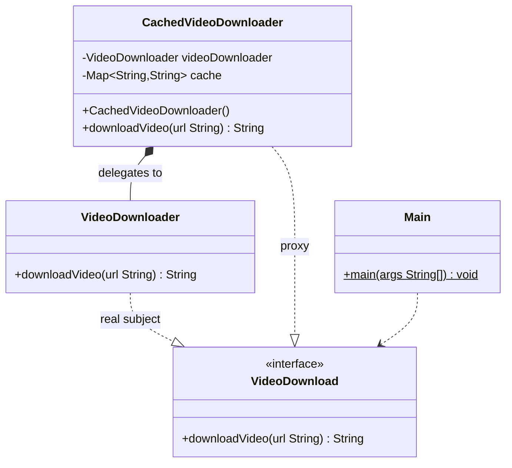

# Proxy Pattern
> Put a stand-in object in front of the real one to control access to it.

**Category:** Structural &nbsp;|&nbsp; **My example:** Video downloader with caching &nbsp;|&nbsp; [Back to main README](../../../README.md) &nbsp;|&nbsp; [Introduction](../../../introduction/README.md)

**Intent:** Provide a surrogate or placeholder for another object to control access to it.

## Contents

[Code in this folder](#code-in-this-folder) · [Problem](#the-problem) · [Solution](#the-solution) · [Class diagram](#class-diagram) · [Who plays what](#who-plays-what) · [Pros and cons](#pros-and-cons) · [When to use](#when-to-use-it) · [What I learnt](#what-i-learnt) · [Things to improve in my code](#things-to-improve-in-my-code) · [Interview questions](#possible-interview-questions) · [My notes](#my-handwritten-notes)

## Code in this folder

```text
proxyPattern/
├── problem/
│   ├── Main.java
│   └── VideoDownloader.java
└── proxyPatternExample/
    ├── interfaces/
    │   └── VideoDownload.java
    ├── proxyLayer/
    │   └── CachedVideoDownloader.java
    ├── Main.java
    └── VideoDownloader.java
```

- `problem/` - the code *without* the pattern, showing why it hurts (the comments at the top of `Main.java` explain it).
- the `...Example/` folder - the same requirement solved *with* the pattern.
- `diagrams/` - Mermaid class diagrams (Lucidchart-ready). `notes/` - photos of my handwritten notes.

## The problem

User 1 downloads a video from a URL, then user 2 downloads the **same** video - and `VideoDownloader` does all the work twice.
Adding a cache inside `downloadVideo()` would work but breaks the Single Responsibility Principle (downloading + caching in one method).

## The solution

Create a `VideoDownload` interface. The real `VideoDownloader` implements it, and so does `CachedVideoDownloader` - the **proxy**.
The proxy holds the real downloader and a `Map<String, String>` cache: if the URL is cached it returns the cached video, otherwise it delegates to the real one and stores the result.
The client codes to `VideoDownload`, so it doesn't know whether it talks to the proxy or the real thing.

## Class diagram

> **Lucidchart:** copy the code block (or open the matching file in [`diagrams/`](diagrams/)), open a new Lucidchart document, choose **Diagram as code** (the `</>` icon), paste it and Lucidchart builds the class diagram. Details are in the [main README](../../../README.md#class-diagrams-and-lucidchart). GitHub also renders the same block as a diagram.



*Same as your notes: `VideoDownload` interface, real `VideoDownloader`, and `CachedVideoDownloader` that holds a `Map` cache.*

Legend: `..|>` implements - `--|>` extends - `..>` depends on / creates - `-->` association - `o--` aggregation - `*--` composition. `+` public, `-` private, `#` protected, `~` package, `$` static, `*` abstract.

### Who plays what

| Role in the pattern | Class in my code |
|---|---|
| Subject (interface) | `VideoDownload` |
| Real subject | `VideoDownloader` |
| Proxy | `CachedVideoDownloader` |
| Client | `Main` |

## Pros and cons

**Pros**

- Performance optimisation
- Access control
- Lazy initialisation
- Added functionality

**Cons**

- Adds complexity
- Delay in access of the real object
- Maintenance overhead

## When to use it

**Use it when**

- Object creation is expensive and you want to delay it
- You want to control access to sensitive operations or add permissions
- You are interacting with remote objects
- You need lazy loading

**Avoid it when**

- No access control, caching or lazy loading is needed - the extra layer is just noise

**Real-world examples**

- Firewall
- Instagram private profile
- Caching layers
- Spring AOP (`@Transactional`, `@Cacheable`)

## What I learnt

- Proxy provides a **surrogate or placeholder for another object to control access** to it. Instead of talking to the real object, the client talks to a proxy that acts on its behalf.
- Think of it as a **layer**: the client talks to the layer; if the layer allows it, the layer talks to the service and passes the answer back. *We don't interact with websites directly - there is a proxy layer between us.*
- Types of proxy: **Virtual** (controls access to an expensive-to-create resource), **Protection** (access based on permission), **Remote** (object located remotely), **Smart** (adds extra behaviour during access).
- Putting caching inside `downloadVideo()` would violate SRP - the proxy keeps that concern separate.
- The proxy and the real class share one interface, so they're interchangeable for the client.

## Things to improve in my code

Small things I noticed while reviewing the examples - good practice for spotting issues in an interview too:

- **Real bug in `Main`:** the first call uses `"htttps://google.com"` (three `t`s) and the second `"https://google.com"`. The keys differ, so **both calls are cache misses** and you never see the *Returning the cached Video* line. Fix the typo to see the cache work.
- `CachedVideoDownloader` creates `new VideoDownloader()` itself and stores it as the concrete type. Accept a `VideoDownload` in the constructor (dependency injection) so any subject can be wrapped.
- The `HashMap` cache is unbounded and not thread-safe. Use `ConcurrentHashMap` and an eviction policy (LRU/TTL).
- There is a stray double semicolon (`;;`) after the `cache` field.

## Possible interview questions

Click a question to see a short answer.

<details>
<summary><b>1. What is the Proxy pattern?</b></summary>

A structural pattern where a stand-in object with the same interface controls access to the real object (caching, lazy loading, security, remote access).

</details>

<details>
<summary><b>2. Name the types of proxy.</b></summary>

Virtual (lazy creation), Protection (permissions), Remote (object in another address space), Smart (extra bookkeeping like reference counting, logging, caching).

</details>

<details>
<summary><b>3. Proxy vs Decorator?</b></summary>

Both wrap an object with the same interface. A proxy manages *access/lifecycle* of the real subject (often creating it itself); a decorator *adds behaviour* to an object given to it.

</details>

<details>
<summary><b>4. Proxy vs Adapter?</b></summary>

Adapter changes the interface; Proxy keeps the same interface.

</details>

<details>
<summary><b>5. Which proxy type is `CachedVideoDownloader`?</b></summary>

A caching (smart) proxy; it can also be seen as a virtual proxy since it avoids repeating expensive work.

</details>

<details>
<summary><b>6. How does Java create proxies at runtime?</b></summary>

`java.lang.reflect.Proxy` (interfaces), CGLIB/ByteBuddy (classes). Spring AOP and Hibernate lazy-loading use them.

</details>

<details>
<summary><b>7. What are the pitfalls of a caching proxy?</b></summary>

Stale data (needs TTL/invalidation), unbounded memory, thread safety, and key normalisation (like the `htttps` typo).

</details>

<details>
<summary><b>8. How is a reverse proxy like nginx related?</b></summary>

Same idea at network level: clients talk to the proxy, which forwards to backend servers and can cache, authenticate or load-balance.

</details>

<details>
<summary><b>9. How would you unit-test the proxy?</b></summary>

Inject a mock real subject and verify it is called once for repeated identical URLs and again for a new URL.

</details>


